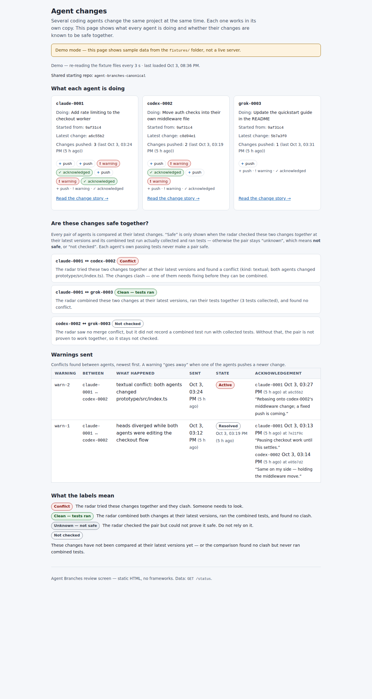

# Agent Branches

Give each coding agent a repository fork, track its latest commit, and check how concurrent changes combine before merging them. An authenticated client tests pairs of changes and records conflict warnings for the agents to acknowledge or fix.



## Try it locally

Requires Node.js 22 or newer (tested with Node 24), Python 3.10 or newer, uv, Git, and npm.

```bash
git clone https://github.com/alexeygrigorev/cloudflare-agent-git.git
cd cloudflare-agent-git/prototype
npm install
npm run build:node
uv sync
uv run python demo/pair-example.py --backend local --interactive
npm run test:all
```

The walkthrough script starts a local coordinator and Git sidecar, then pushes a commit and verifies the callback. It submits checks before removing temporary state and stopping its processes.

## Watch the demo

[Watch the submitted demo on Loom](https://www.loom.com/share/f8b67486801b4cee8d8970fa3d405553). Alexey submitted the project on 15 October 2026; [submission confirmation](_docs/founder-journal/2026-10-15.md). The [earlier approved recording](docs-submission/videos/agent-branches-demo-draft.mp4) remains historical evidence from the Node runtime. The Cloudflare Worker is now live at https://agent-branches.cloudflare-ai-agent-de9ca0.workers.dev. The full live smoke run passed (14/14 checks, 60 operations): two concurrent agents on real Artifacts repositories, merge-tree checks, and the auth and stale-vector refusals (see [COST.md](docs-submission/COST.md)). [Recording details and SHA-256](docs-submission/VIDEO.md).

## Cloudflare entry

The Cloudflare adapter uses a Worker, one SQLite-backed Durable Object, and the Artifacts Git repository binding. Agents and test runners execute on developer computers while the coordinator records their results. The Node adapter supports local testing.

[Prototype instructions](prototype/README.md) · [Submission text](docs-submission/SUBMISSION.md) · [Cloudflare costs and limits](docs-submission/COST.md) · [Demo script](docs-submission/DEMO-SCRIPT.md)

## Root scheduling switch (scripts/root/rootctl)

`scripts/root/rootctl` is one switch for BOTH schedulers of the interim headless
root. It is not a cutover switch and it is never inverted.

```bash
scripts/root/rootctl stop     # Hub scheduling OFF and headless-root.timer OFF
scripts/root/rootctl start    # Hub scheduling ON and headless-root.timer ON
scripts/root/rootctl status   # readonly report of both actual states
scripts/root/rootctl status --json
```

`stop` sends `PUT /api/root/scheduling {"enabled": false}`, verifies the
readback, then runs `systemctl --user disable --now headless-root.timer` and
verifies the timer is not enabled and not active. `start` is fail-closed and
ordered: `PUT {"enabled": true}`, verify the `GET` readback, then
`systemctl --user enable --now headless-root.timer`, verify the timer, then
verify the Hub once more.

Timer readback is systemd-faithful: `systemctl is-enabled` exits 1 for
`disabled` and `is-active` exits 3 for `inactive` while still printing the state
on stdout, so rootctl reads that state word regardless of the exit code and
treats only an empty or unrecognised stdout (`Failed to connect to bus`) as
unknown. The transitional states `activating`, `deactivating`, `maintenance` and
`refreshing` are unknown and fail-closed: they are never called on or off, and
`stop` with a transitional timer never claims `both_off` with exit 0. (`reloading` reports
active with a reload in progress and stays ON.) Unknown always stays
fail-closed.

Every command reports a verdict derived from actual readbacks only: Hub
(on/off/unknown) x timer (on/off/unknown) as `both_on`, `both_off`,
`hub_on_timer_off`, `hub_off_timer_on`, `hub_on_timer_unknown`,
`hub_off_timer_unknown`, `hub_unknown_timer_on`, `hub_unknown_timer_off` or
`hub_unknown_timer_unknown`. A verdict is the last observed state; the exit
code and the `errors` say what failed, so a command can exit non-zero and still
report `both_on` when a compensating write did not confirm.

A failed `start` restores the intent its own pre-check observed: it disables the
Hub only if the Hub was off before, and turns the timer off again only after
`timer_on` was actually attempted (a Hub-stage failure that never touched the
timer sends no `disable --now`). It never turns off scheduling or a timer it
did not enable because of a transient read failure. Only a definite PUT refusal
(HTTP 401/403 from the PUT itself, before it is acknowledged) never took
effect, so no compensating PUT is sent and the auth exit 4 is preserved instead
of being masked by an unknown-restore exit 3; if the PUT is acknowledged and a
later GET readback returns 401/403, the Hub may have been changed, so a
compensating PUT is attempted and the step never claims nothing was changed.
Only a definite PUT 401/403 skips compensation, other 4xx/5xx still compensate
because the write may have taken effect. A divergent pre-check (enabled xor active) cannot be
restored exactly with `enable/disable --now`: when start never touched the
timer it is left as found, and when start did change the timer the report says
so explicitly and records the exact pre-check flags as not-restored, never as
"left untouched" and never as "already enabled+active". An unreadable timer
pre-check refuses `start` before any Hub change, so a transient outage can
never open a brief scheduling-on window. If a compensation itself fails, the
report says the state is now unknown and exits 3; an unknown is never described
as safe, off or restored. `stop` is best effort on both sides and never
re-enables the Hub when the timer step fails.

`start` and `stop` take the exclusive lock (`ROOTCTL_LOCK`, default
`~/.local/state/headless-root/rootctl.lock`); `status` takes a shared one, never
creates a lock file and reports `linearizable` as held-and-uncontended (true
only when the shared lock is held without contention; false beside a mutating
rootctl, because an observation beside a mutator is not a linearizable read).
Read `lock.contended` as the concurrent-mutator signal. Bounds: `timeout_sec` (default 10s) is a total budget per HTTP call
covering name resolution, connect and body reads. Every timeout value, from the
config file or `ROOTCTL_HUB_TIMEOUT`, must be finite and numeric and is clamped
to 1..60s; a non-numeric, non-finite or overflowing timeout (including huge
integers that overflow to float and `ROOTCTL_LOCK_WAIT`) is a sanitized usage
error (exit 1) with no traceback that sends nothing and touches nothing. A
`token`, `csrf_token` or `cookie` containing a control character or a
non-latin-1 character is refused as a sanitized usage error without echoing the
value, and any unexpected error is a sanitized one-line `unknown` with no
traceback and no secret. A 3xx is refused instead
of followed so the credential is never forwarded, environment proxies are not
used for the credentialed call, every `systemctl` call is bounded at 20s, Hub
response bodies are bounded at 64 KiB, and `ROOTCTL_TIMER_UNIT` may only name a
`.timer` unit (a `.service` name is refused). `stop` takes a fresh Hub GET after
the timer step, like `start` does, and a failed final GET is exit 3 unknown
with the earlier observation flagged stale, never a verified exit 0: an exit 3
with verdict `both_off` means the pre-check was unverified but the final state
verified off, while a final-GET failure never reports verified success.

Exit codes: `0` verified, `1` usage or configuration, `2` verified divergence or
partial failure, `3` unknown (unreachable, timeout, malformed JSON, non-boolean
`enabled`, non-UTC `updated_at`, unreadable timer, failed compensation), `4`
auth denied (401/403), `5` another rootctl holds the lock. A non-zero exit always
carries the truthful partial state in the report, never a guess.

Configuration uses the existing supported formats only, as in
`scripts/quota-gate.py`: a JSON file with `hub_url`, `token`, `auth_mode`,
`host_id` and `timeout_sec`, found through `--config`, `ROOTCTL_HUB_CONFIG`,
`QUOTA_HUB_CONFIG` or `.local/quota-hub.json`, with `ROOTCTL_HUB_URL`,
`ROOTCTL_HUB_TOKEN`, `ROOTCTL_HUB_HOST_ID` and `ROOTCTL_HUB_TIMEOUT` as
overrides, plus `ROOTCTL_HUB_CSRF_TOKEN` and `ROOTCTL_HUB_COOKIE` for session
auth (`csrf_token`, `cookie`). The host quota-launcher variables `QUOTA_HUB_URL`, `QUOTA_HUB_TOKEN`,
`QUOTA_HUB_HOST_ID` and `QUOTA_HUB_TIMEOUT` are never read here, so a host quota
credential can never silently override the admin config and a foreign
`QUOTA_HUB_URL` can never receive the admin token. The Hub URL is printed as
`scheme://host:port` origin only, never with path segments.
`auth_mode` must be stated explicitly (`bearer` or `session`); rootctl does not
guess. **The admin credential:** a bearer `token` must be an admin credential of
the Hub. The token in the shared `.local/quota-hub.json` is the host quota
credential and is NOT an admin credential, so that file cannot be used
unqualified. Session auth uses the CSRF token and cookie (`csrf_token`,
`cookie`) already held by an existing Hub custodian session; that session is the
supported custodian path and no new credential, key, service or config file is
created. rootctl reads no credential store and never prints a credential value:
tokens, CSRF tokens, cookies and reflected echoes are redacted from all output,
and a `hub_url` carrying userinfo, a query or a fragment is refused rather than
printed. A config whose mode is not 0600 produces a warning that names the file
and the octal mode only.

In-flight work is never disturbed: rootctl only ever enables or disables
`headless-root.timer`. It never stops `headless-root.service` or its transient
scopes and never touches `root.lock`, `state.json` or `runs/`. There is no
`--pause-session` flag: the Hub defines no pause endpoint, so argparse refuses
the flag on every subcommand instead of pretending to pause, and a config that
declares `session_pause` is refused. A pause needs a Hub contract first and a new
explicit human decision.

Rollback is `rootctl stop` (or `rootctl start`), not a generic restore. rootctl
has exactly two target states and compensates a failed start back to the state
its pre-check recorded; it does not implement restore-previous-arbitrary-state.

Offline tests: `python3 tests/checks/test_rootctl.py` (97 tests: a fake
`systemctl` that reproduces real systemd exit codes plus local mock Hubs on
127.0.0.1). They prove the client contract, ordering, fail-closed behaviour,
idempotence, redaction, URL hygiene, redirect and proxy refusal, the total HTTP
budget, deep-JSON boundary, PUT-ack vs readback-auth, urlsplit usage, the
verdict vocabulary and concurrency handling, and they read no
gitignored file, so they pass in a clean checkout of just these two files. They
do not prove live Hub behaviour, the live admin credential or that two real
Hub-dispatched root cycles occurred. Live verification and any reversible
human-authorized test are separate, explicitly authorized steps, and the rollback
for such a test is a recorded `stop`.

MIT licensed.

## Stopping and starting

See [_docs/stop-start.md](_docs/stop-start.md) for how to stop and start the Hetzner headless root and the Win35 guardian.
