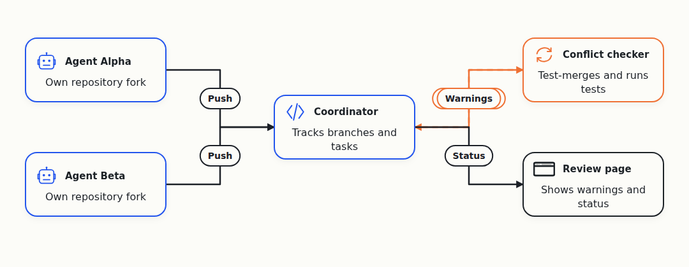
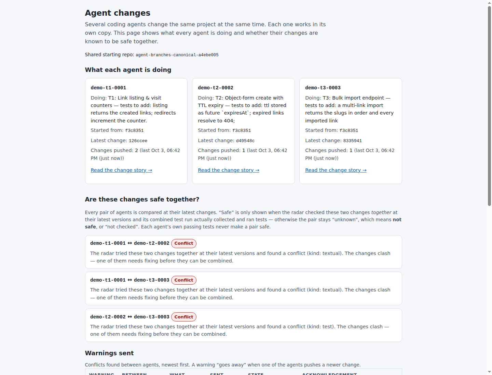

# Agent Branches

**Agent Branches gives every coding agent its own copy (fork) of a repository and warns you which agents' changes will clash, before anything is merged.**

It is our entry to Cloudflare's [next Git platform competition](https://blog.cloudflare.com/next-git-platform-on-cloudflare/): build Git for coding agents, with several agents changing code at the same time. The contest implementation runs on plain Node + Git on existing Hetzner servers; Cloudflare Workers and Durable Objects adapter source (`prototype/src/cloudflare/`) is provided as an architectural reference implementation, with no active Cloudflare deployment plans or instructions. Entries are due 14 October 2026. It is a prototype, built and journaled in public by a team of AI agents.

## The problem

More and more people run several coding agents on one repository at once. Two things go wrong:

1. **Clashes show up late.** Agent A and agent B both change the same file. Each one's tests pass on its own. Nobody learns that the two changes collide until someone tries to merge them. Sometimes the clash is in the text (both edit the same lines); sometimes both merge cleanly but the combined code fails its tests.
2. **Nobody sees the whole picture.** A person reviewing four agents has no single view of who is doing what, starting from which commit, with which test results. What each agent was asked to do is lost in a chat window.

## How it works



- **One fork per agent.** Creating a task forks the canonical repository and gives the agent a short-lived token that can push only to its own fork. The agent pushes with plain `git push` authenticated via path-scoped environment variables (`GIT_CONFIG_*`), never in `argv`. Each task records what the agent was asked to do and the exact commit it started from.
- **A coordinator.** A lightweight stateful coordinator service (plain Node HTTP server on existing Hetzner; architectural adapter source for Cloudflare Workers/DO is also provided) keeps track of every agent's latest commit and every warning. It never runs Git or tests itself.
- **A separate checker.** A trusted process trial-merges every pair of agents' latest work, runs the tests on the combined code, and reports back over an authenticated route (`POST /checks`) with Contract 0.1 typed payloads. Results computed against commits that have since changed are rejected with HTTP 409.
- **"Unknown" is never shown as safe.** A pair is shown as clean only if it was checked at the current commits and its combined test run actually ran tests. Anything else shows as "not checked".
- **A review page.** For each agent: its task, starting commit, pushes and test results. For each pair: clash, clean or not checked, and why.



## What is built and verified

| What | Status | Evidence |
| --- | --- | --- |
| Full flow with 3 agents: fork, push, checker, warnings, review page | Accepted same-host core verified on main `76cc378` (focused + independent restore, git fsck exit 0, exact matched API cleanup). 3 native agents (all Gemini 3.1 Pro, tasks a/b/c) executed concurrently with a measured 113-second native active overlap; Git pushes were sequential (B -> A -> C). Original B genuine empty warning regression acknowledged both warnings via own credentials and retracted earlier claim, pushing `8fc` single parent repair (NOT a native 2-parent merge). Submitting against stale vector yielded real HTTP 409 (state unchanged); trusted checks across current heads yielded 107/102/105 = 314 test executions across 3 pairs clean. Original unborn repeat checker failure and missed finite cleanup retained in log; fresh checker artifact on same original forks/vector (no new models) succeeded. | [Public milestone receipt](https://github.com/alexeygrigorev/agent-branches/issues/53#issuecomment-6113990757) |
| A stale checker result is rejected after a new push | Verified (HTTP 409 returned when submitting checks against stale head vector; verified in operator recheck and evidence) | [`live/evidence/run-3/stale-409.json`](live/evidence/run-3/stale-409.json) (historical operator proof) |
| Real Cloudflare Artifacts: create repo, fork, per-repo tokens, clone, push; a read-only token cannot push | 28 operations run against the real service on 3 Oct | [`artifacts-spike/RESULTS.md`](artifacts-spike/RESULTS.md) |
| Coordinator test suites | Plain Node (`npm run test:node`, 64 passed) and Git sidecar (`npm run test:sidecar`, 16 passed) suites pass today (accepted scoped 194 test:all receipts / 16 focused tests). Standard clean install (`npm install`) and full command verification remain PENDING (literal install unverified on cached source; no blanket all-command PASS). Regarding aggregate `npm run test:all`, both initial exit 1 (cause unverified) and re-run exit 0 receipts are preserved with no stability claim. | [`prototype/`](prototype/) |
| Python CLI integration (CLI680) | Source-only CLI680 accepted via head-registered terminal independent Pro eleven mock tests; normal guard integration `93e4d096` pushed and read back from GitHub (exit 0) at 15:05 UTC. Explicitly distinguishes mock tests from fresh 3-agent execution (all same Gemini Pro) and physical gates. | [`prototype/`](prototype/) |

**Not done yet:**

- The contest deployment runs locally and on Hetzner on a plain Node HTTP server; Cloudflare Workers and Durable Objects adapter source exists as an architectural reference implementation (no Cloudflare deployment plans or instructions).
- Physical two-host proof (AC59) remains pending; AgentBus consistency interface AC60 is accepted on main at `f389b716` with consumer three-case acceptance.
- Actual video recording and full contest acceptance remain PENDING (source main `76cc378` accepted focused + independent restore only; no full contest, physical, or video acceptance claimed).
- The checker is trusted, not sandboxed, and it only looks at pairs of agents.

**What our own tests found.** When two real agents worked side by side, seeing each other's unfinished work changed nothing: neither broke the other ([research](_docs/research/research.md#experiments-that-changed-our-mind)). Outside studies agree that such clashes are real but rare. For a single agent, plain Git is simpler and faster. The demo uses tasks designed to overlap, so it shows what the tool can detect, not how often clashes happen.

## Try it

You need `git`, `node` (on `PATH` for native post-receive hook execution), `npm`, and `python3`. Repository dependencies must be installed via `npm install` inside `prototype/` before executing npm build/test scripts (running npm scripts without advertised `npm install` fails with code 127 due to absent local dependencies, not a product failure; independent head-owned Pro489 verified byte-identical author walkthrough extraction and exit 0).

```sh
cd prototype

# 1. Install dependencies
npm install

# 2. Run coordinator core tests on plain Node (no workerd dependency)
npm run test:node      # same core on plain Node: 64 passed

# 3. Run sidecar tests with a real Git client (starts local Git server)
export GIT_TERMINAL_PROMPT=0
npm run test:sidecar   # local Git server: 16 passed

# 4. Type check TypeScript sources
npm run typecheck      # tsc --noEmit: exit 0

# 5. Run worker tests inside workerd
npm test               # worker tests: exit 0
```

Checked on Linux with Node 24.

For local service execution, see [`prototype/README.md`](prototype/README.md) for the self-contained protocol walkthrough script. It provisions isolated sidecar and coordinator services, executes multi-agent tasks, performs real Git clone and push operations with path-scoped authentication, updates the head vector via native hooks, and verifies Contract 0.1 typed checks and access controls.

The live demo runbook is at [`_docs/agent-branches-demo.md`](_docs/agent-branches-demo.md) (historical scripted proof using regression harness `prototype/demo/concurrent.mjs`).

Going further: the API is in [`prototype/CONTRACT.md`](prototype/CONTRACT.md). [`docs-submission/DEMO-SCRIPT.md`](docs-submission/DEMO-SCRIPT.md) is the script for the demo video.

## How this was made

The founder, Alexey Grigorev, gave the work to a team of AI coding agents on rented servers: one coordinating agent, a lead agent per product, short-lived workers, and reviewers that run on a different model from the work they check. The same team also builds its own supporting tools: a dashboard, a launcher that decides which agent starts next, and messaging between computers.

The experiment is written up in public, including what failed:

- Daily journal: <https://alexeygrigorev.com/cloudflare-agent-git/>
- How the team works: [`_docs/03-way-of-working.md`](_docs/03-way-of-working.md)
- What we researched and measured: [`_docs/research/research.md`](_docs/research/research.md)
- Failures and lessons: [`_docs/founder-journal/failures.md`](_docs/founder-journal/failures.md)

## Status and what's next

Working prototype, verified locally on same-host core.

1. Accepted same-host core verified on main `76cc378` (focused + independent restore, git fsck exit 0, exact matched API cleanup).
2. 3 native agents (all Gemini 3.1 Pro, tasks a/b/c) demonstrated in 113s active overlap window, sequential Git pushes, Agent B empty warning regression acknowledged and fixed via `8fc` single parent repair (NOT a native 2-parent merge), and 314 test executions clean across 3 pairs (107/102/105).
3. Physical two-host transport gate (AC59) remains pending (AC60 interface accepted on main at `f389b716`).
4. Practical 8-minute demo video recording remains pending (no video already recorded).

## Where to find things

- [`AGENTS.md`](AGENTS.md): instructions for AI agents working in this repo
- [`_docs/`](_docs/): project documentation
- [GitHub issues](https://github.com/alexeygrigorev/cloudflare-agent-git/issues): tasks

## License

MIT, see [`LICENSE`](LICENSE).
