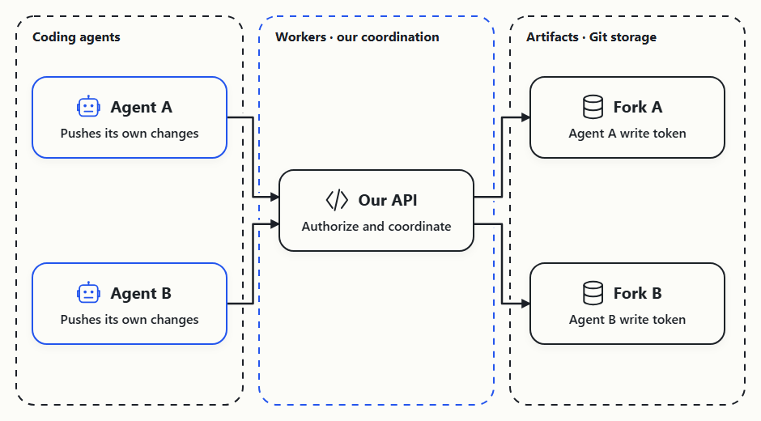
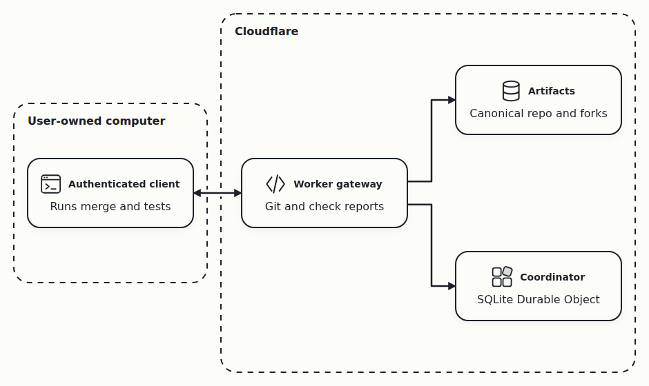

# Agent Branches demo

At the beginning, I had a storage problem: I was running out of space. I solved that by getting a 1 TB network drive for €3 a month.

That solved the space problem. Coordinating the agents' changes is a separate problem. I'm not building a better Git. I'm building a coordination layer for coding agents on top of Git.

Git stores and merges changes. Agent Branches tracks who is changing what and whether their latest changes have been checked together.

The main idea is to catch conflicts while agents are still working, before merging their changes into the main branch. As agents push updates, we check the current combination and surface any conflict so they can coordinate a fix before integration.

Knowing about a conflict early gives us time to act: agree who changes the shared file, adjust the tasks so they do not overlap, or rebase one change onto the other. We can then check the updated commits again and make the final merge easier.

Git already manages changes; I help agents coordinate them.

## What problems did we investigate?

Before building, we investigated problems people report while using Git with coding agents. We turned that research into [20 product hypotheses](https://alexeygrigorev.com/cloudflare-agent-git/hypotheses/), with the problem, proposed solution, evidence and next test for each idea.

The problems included changes that break when combined, workspaces that consume too much disk space, difficulty reviewing an agent's work, and lost context when a task changes hands. Other ideas addressed overlapping work, slow test feedback, unsafe Git permissions and changes spanning several repositories.

We took four ideas from that research for this project:

- [Live Integration Radar](https://alexeygrigorev.com/cloudflare-agent-git/hypotheses/live-integration-radar/): check the agents' unfinished changes together and warn about conflicts before integration.
- [Exact-SHA verification receipts](https://alexeygrigorev.com/cloudflare-agent-git/hypotheses/exact-sha-verification-receipts/): tie each result to the exact commits that were checked, so an old passing test cannot stand in for a newer change.
- [Quarantine forks + capability tokens](https://alexeygrigorev.com/cloudflare-agent-git/hypotheses/quarantine-forks-capability-tokens/): give each agent its own fork and limit where its token can write.
- [Change-story review](https://alexeygrigorev.com/cloudflare-agent-git/hypotheses/change-story-review/): put the changes, checks and warnings together so a reviewer can understand what happened.

The demo concentrates on one question: can we check the agents' changes together before merging them into the main branch? These ideas remain research directions; the demonstration does not establish an advantage over ordinary Git workflows.

## Demo

Git worktrees already give agents separate working directories and branches. The useful difference is the coordination layer: tracking each agent's latest commit, checking combinations, and exposing conflicts, stale tests or missing evidence. That layer could work with worktrees too.

Here, Cloudflare forks offer separately scoped remote write access. Artifacts stores the Git repositories; Workers runs our coordination API. The coordination logic is the part we're building.



### 1. Storage, coordination and checks

We store agents' Git forks on Cloudflare Artifacts, coordinate their changes through a Worker and a Durable Object, and run checks on a user-owned computer.

- Artifacts: Git-compatible storage for the canonical repository and each agent's fork.
- Worker gateway: handles Git requests, checks access tokens, accepts check reports and exposes the status API.
- Coordinator: a SQLite Durable Object that tracks current commits, check results and warnings without executing agent code.
- Authenticated client: fetches the current commits, runs a merge check and combined tests, and submits the results.



The example can use either Cloudflare or the local Node adapter. Cloudflare mode sends real Git pushes through the deployed Worker to Artifacts. Local mode runs the same example with Git repositories on this computer. In both modes, two agent workspaces configure a checkout service: first their changes are compatible, then the same agents introduce a conflict. The authenticated client runs the checks on this computer.

### 2. Start the example

From the repository root:

```bash
cd prototype
npm install --no-fund --no-audit
npm run build:node
uv sync
```

Choose a backend when starting the demo. For the Cloudflare demonstration, set `BASE_URL`, `ADMIN_TOKEN` and `RUNNER_TOKEN` in the private `prototype/.env` file or your environment, then run:

```bash
uv run python demo/pair-example.py --backend cloudflare --interactive
```

`BASE_URL` must point to the deployed Worker over HTTPS. The program checks the operation allowance and refuses to start when the demo repository inventory is not empty. Use the current backend: startup requires its run-owned cleanup capability. Cleanup removes only repositories registered to this run and preserves unrelated work; an incomplete cleanup is reported for retry.

For a local rehearsal:

```bash
uv run python demo/pair-example.py --backend local --interactive
```

Both modes follow the same visible steps: prepare the demo, register the two agents, make changes, push and read status. Local mode starts its own Git server and coordinator; Cloudflare mode uses the deployed services. Setup establishes the canonical starting commit internally in both modes, so there are no separate seed-commit steps before the agents begin. In interactive mode, every block has a numbered action title, such as `Block 3: Register Agent A's task`. Each command or related block appears between separators and waits for Space before execution. Credentials stay in private temporary files.

It prints a `source` command for a private `demo.env` file. That command loads the actual workspace paths and API credentials into a second Git Bash terminal. With those variables loaded, the current pair and warnings are available through the API:

```bash
uv run branches status --server "$API"
```

The printed UI URL includes the local coordinator's `?api=` address. The UI needs an admin token in its Bearer token field. On Windows, the token can be copied from the second terminal without displaying it:

```bash
printf '%s' "$ADMIN_TOKEN" | clip.exe
```

The example uses the existing Branches CLI installed as a local filesystem dependency for task registration and status, plus real Git commands for the agents' edits and pushes. Commands stand in for the two agents' actions; the example does not launch AI models.

The optional `--plans` flag adds declared-file overlap warnings before the edit blocks. The coordinator stores each agent's planned paths and reports shared paths while the workspaces and commits are unchanged. These are overlap warnings, not proven Git conflicts. This works with the updated local server; Cloudflare requires the current backend deployed before using the flag.

### 3. Compatible changes

Continue the interactive example started above. From `prototype/`, the Cloudflare command is:

```bash
uv run python demo/pair-example.py --backend cloudflare --interactive
```

Space executes the displayed command or block; Enter also works. After the output, another Space reveals the next command. This leaves each result visible for explanation before the next block appears. Blank lines and separators distinguish the blocks. Ctrl+C stops the demo and cleans up the demo repositories and temporary local services.

The setup blocks create the canonical repository, register each agent and clone its fork. Once both workspaces are ready, the UI has two agent tasks, but their new changes have not been checked together yet.

Registering a task tells the coordinator which agent is starting work and what it intends to do:

```bash
uv run branches task create \
  --server "$API" --agent agent-a \
  --intent "Configure checkout limit"
```

The demo configuration supplies the repository, branch and starting commit. The coordinator assigns the task and agent IDs, creates a separate Git fork and issues a write token scoped to that agent. The program prints the returned IDs and fork address after the command runs. It hides the token value. Agent B registers in the same way and gets its own fork.

The next blocks prepare each agent's change, push both updates and inspect the coordinator's status. Each visible block waits for Space. After the pushes, the authenticated client automatically checks the current commits and submits the result; there is no separate manual check step.

Agent A adds `rate.py` with `LIMIT = 10`. Agent B adds `region.py` with `REGION = 'EU'`. They commit and push to their own forks. The program executes these commands in its temporary workspace:

```bash
printf 'LIMIT = 10\n' > agent-a/rate.py
git -C agent-a add rate.py
git -C agent-a commit -m "Add request limit"

printf "REGION = 'EU'\n" > agent-b/region.py
git -C agent-b add region.py
git -C agent-b commit -m "Add region"
```

Each push publishes unfinished work to that agent's own fork using its scoped token. The branch is called `main` inside each fork; it is separate from the canonical repository's `main`. Publishing these commits makes them available for checks before integration. For example, Agent A's push is:

```bash
GIT_CONFIG_COUNT=1 \
GIT_CONFIG_KEY_0=http.extraHeader \
GIT_CONFIG_VALUE_0="Authorization: Bearer $AGENT_A_TOKEN" \
  git -C "$AGENT_A_DIR" push origin main
```

The authenticated client automatically fetches both published commits and checks their combination without changing the canonical main branch. It uses Git internally to preview the combination; there is no manual merge command in the walkthrough. The warning comes before integration into the shared repository. It does not predict unpublished edits in the agents' local workspaces.

The compatible changes produce a combined tree. The client exports that tree and runs one combined test:

```python
import unittest
from rate import LIMIT
from region import REGION

class CombinedConfiguration(unittest.TestCase):
    def test_eu_limit(self):
        self.assertEqual((REGION, LIMIT), ('EU', 10))
```

The check runs one combined test and reports whether it passed. Detailed test output, including `Ran 1 test` and `OK`, is available with `--verbose`. The client submits the result for those exact commits automatically. Reading status is enough to see the outcome:

```bash
uv run branches status --server "$API"
```

The status result reports `clean`, one collected test and no active warning. The terminal also confirms that the changes combine successfully and one combined test passed. The program waits, so the live UI and API retain the compatible result. Internal fetch, comparison and authentication commands stay out of the main walkthrough.

### 4. Conflicting changes

Continue the same running example, advancing each block with Space. The same two agents add `shared.txt`: Agent A chooses `LIMIT=10`; Agent B chooses `LIMIT=20`. Both changes refer to the same checkout setting, and both agents push independently:

```bash
printf 'LIMIT=10\n' > agent-a/shared.txt
git -C agent-a add shared.txt
git -C agent-a commit -m "Choose limit 10"

printf 'LIMIT=20\n' > agent-b/shared.txt
git -C agent-b add shared.txt
git -C agent-b commit -m "Choose limit 20"
```

Each new push invalidates the earlier clean result. While the new combination is being checked, the previous passing result cannot make it look safe. The authenticated client automatically checks the new commits before the demo's next status block.

The internal comparison now reports:

```text
CONFLICT (add/add): Merge conflict in shared.txt
```

The client records a textual conflict for the current pair of commits. The result names both agents and `shared.txt`, and the coordinator reports `conflict` with an active warning. The agents can now coordinate their changes before integration. No combined application test is claimed for this conflicting tree.

The program pauses again. The same UI and API now show the conflict and active warning, while the canonical main branch remains unchanged. Git detected the conflict; the coordination layer ties it to the two agents' current work and makes it visible before integration.

### 5. Finish

Space at the final conflict pause removes the demo repositories and stops its temporary local services. The terminal confirms that canonical main stayed unchanged and that cleanup completed.

The same example can run without pauses for verification:

```bash
uv run python demo/pair-example.py
```

It must complete both stages: a real clean merge with one passing combined test, followed by a real conflict in `shared.txt` and an active warning. The default command runs locally. A successful Cloudflare run must use `--backend cloudflare`; local results do not establish that the deployed Worker and Artifacts worked.


### 5. Coordination outside the recording

The reusable CLI is installed by `uv sync` from the repository's local package. Configure the coordinator once per project, then create tasks without repeating repository, branch or starting-commit flags:

```bash
uv run branches configure --server "$BASE_URL" --repo "$CANONICAL_REMOTE" \
  --admin-token-file "$ADMIN_TOKEN_FILE" --runner-token-file "$RUNNER_TOKEN_FILE"
uv run branches task create --agent agent-a --intent "Configure checkout limit" --files rate.py
uv run branches task create --agent agent-b --intent "Configure region" --files region.py
```

Configuration and task credentials stay in a private file outside the repository. The authenticated client needs the relevant scoped fork credentials as well as its check-submission token. A separate computer needs those credentials provisioned explicitly; a runner token does not grant access to agent forks.

Keep the authenticated client running on a user-owned computer with an explicit test command:

```bash
uv run branches watch --test-command 'python -m unittest discover -v'
```

The checker reads structured unittest or pytest results. Printed success messages alone, unsupported commands, zero tests and entirely skipped suites leave the result unknown.

Agents can publish from their own configured checkout:

```bash
uv run branches publish --task-id "$TASK_ID"
uv run branches status
```

`publish` verifies that the checkout's remote is the task's own fork before pushing. The watcher notices independently published commits, checks their combination and submits version-specific evidence. Status remains unknown until matching evidence arrives; it is not a synchronous promise that every push is already checked.

Agents can declare an overlap before editing:

```bash
uv run branches plan --task-id "$TASK_A" --files shared.txt
uv run branches plan --task-id "$TASK_B" --files shared.txt
uv run branches status
```

The warning names the agents and `shared.txt`, so they can agree ownership before doing more work. A declared overlap is not proof that the eventual changes conflict. Unreported local edits remain invisible to the coordinator.

These reusable CLI improvements were implemented after recording. The [submitted recording](https://www.loom.com/share/f8b67486801b4cee8d8970fa3d405553) and [submission confirmation](founder-journal/2026-10-15.md) are recorded separately.
