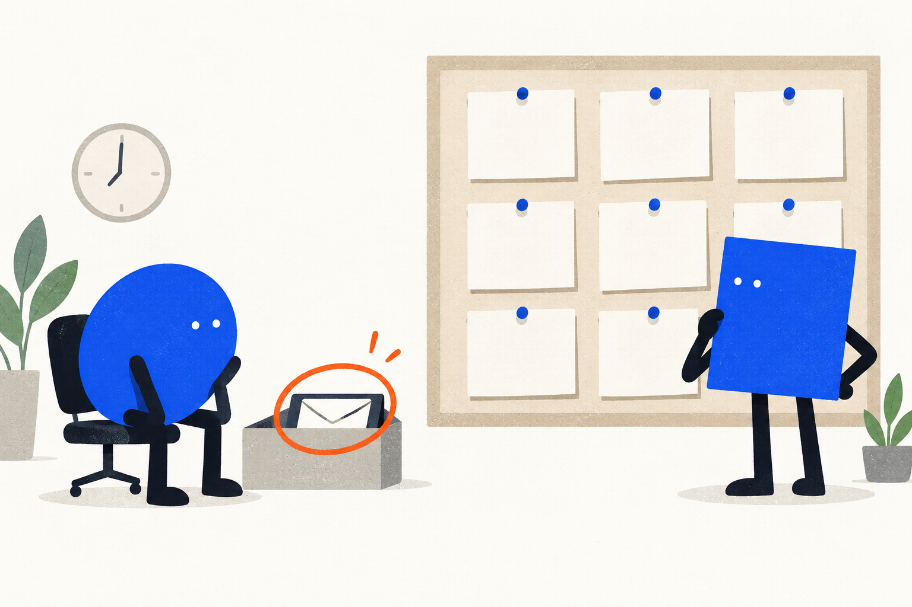
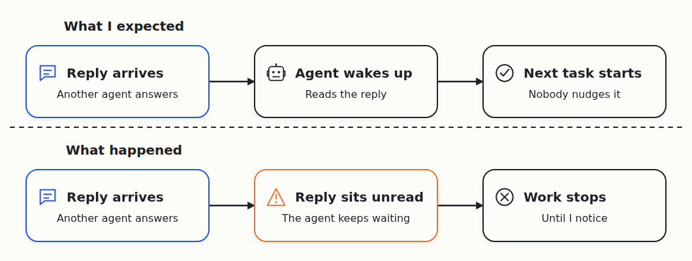
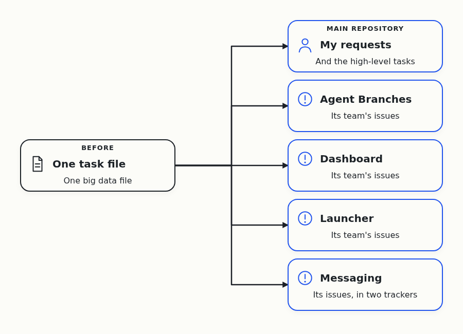
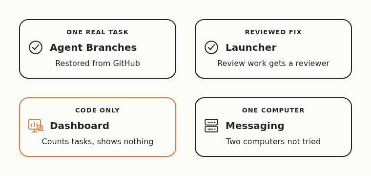
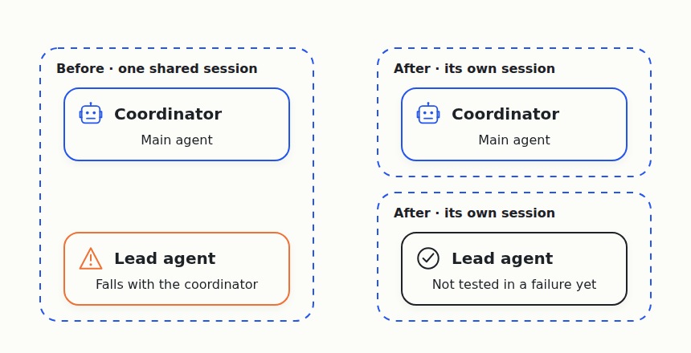

# Day 5: Nothing Woke the Agents, So My Requests Moved Into the Open

On October 1, Cloudflare announced a [competition to build the next Git platform](https://blog.cloudflare.com/next-git-platform-on-cloudflare/). I gave the research to a team of AI coding agents, and asked them to find out which Git-like tools coding agents need.

I run into this problem myself. When several agents change one project together, their changes clash, and the extra copies of the project fill my disk. I want Git that works when many agents use it at the same time.

The agents work in four teams. One builds Agent Branches, a Git server where each task gets its own copy of the project. The other three build a dashboard, a launcher that decides which agent starts next, and messaging between my desktop and my server.

Yesterday I set a simple test for the repaired wake-up service, a small program that nudges idle agents. It had to keep them working through a whole night.

## Nothing woke the main agent

Early in the morning I found the main coordinating agent idle again. Nothing had woken it, and none of the other lead agents had started a replacement. By late morning it sat idle a second time.

The regular status checks listed problems and stopped there, with no step to fix any of them. I told the agents that a check that only reports is pointless.

Another agent that was supposed to start five tasks sat waiting for a nudge. Elsewhere, an agent answered a question, but the answer went to an inbox, and nothing woke the agent that had asked.

So the problem is bigger than one stuck service. A reply, a finished task or a missing agent should each lead to the next step without me. I asked the agents to keep every message I send in one public [founder journal](https://github.com/alexeygrigorev/cloudflare-agent-git/blob/main/_docs/founder-journal/2026-10-07.md).

## Every request now gets a public issue

The tasks lived in one big data file that was hard to follow. I asked for a better tracker that holds every request I make.

The agents [moved every task into public GitHub issues](https://github.com/alexeygrigorev/cloudflare-agent-git/commit/a6182098dd3232bd17c6dcca307b6ae79d44a37a). Each product team owns its own tracker, and the main repository holds my requests and the high-level tasks.

The move closed old finished tasks in one batch, so their closing dates show when a task moved, not when the work was done. Honest task numbers for the day aren't available yet.

The dashboard team built the counter I asked for, to sit next to the counts of active agents and commits. It [counts a task as resolved](https://github.com/alexeygrigorev/cloudflare-agent-git/commit/905b592247085707c1c05a00bee95d155a1ea299) only after a reviewer accepts it, skips cancelled and queued work, and keeps unknown dates unknown. It doesn't read the new GitHub issues yet, and nothing shows on the dashboard.

The agents also cleaned up the documentation. It now lives in one folder, with one research file and one set of instructions for every agent.

## Small fixes in each product

An agent used Agent Branches to send a small piece of its own work to GitHub without touching the shared copy of the project. The first attempt failed, because the command loaded an older copy of the tool that lacked the new command. The agent changed how Python finds the tool and tried again.

Then [a separate reviewing agent](https://github.com/alexeygrigorev/cloudflare-agent-git/commit/c53f57442b5ff40c9d26c9b47ecdf9b8676d7e4b) downloaded a fresh copy from GitHub, found identical files and ran eight tests that passed. That proves the tool works for one task, not that it beats plain Git.

The launcher got a reviewed fix. When an agent describes review work only in a task's goal, the launcher [now recognises it and starts a reviewer](https://github.com/alexeygrigorev/cloudflare-agent-git/commit/06244d46a16f5f44a242ec35b21911bd32709f9e). A broken or duplicate request gets a clear error, and the same request sent twice starts only once.

The messaging team [built a receiver](https://github.com/alexeygrigorev/cloudflare-agent-git/commit/826f5d9e969ced257c6ce91299d184467b6b702e) for my desktop. My home network accepts no incoming connections, so the desktop has to reach out to the server and collect its messages. A live test passed, but both ends ran on one computer, even though its report called it a two-computer test. Two real computers still haven't talked.

## Lead agents died in the afternoon

In the afternoon, a shared login session on my server ended, and several lead agents died with it. Nobody knows yet what ended the session.

The agents brought the same lead agents back from their saved conversations, by hand. One of them had been running inside the main coordinator's session, so losing the coordinator could take it down too. The agents restarted it in a session of its own.

The script that should bring agents back without anyone watching [doesn't exist yet](https://github.com/alexeygrigorev/cloudflare-agent-git/issues/102). In the evening, the agents added [a regular check on the main agent](https://github.com/alexeygrigorev/cloudflare-agent-git/commit/22e2b29a563fe466561070260c2fad8c78158fee) that counts missed answers. For now it [only raises an alert](https://github.com/alexeygrigorev/cloudflare-agent-git/commit/cf79a045c308045ba199febc3adbd2931969dcd1) and restarts nothing.

## Five days in

I wanted my requests to happen without me chasing them. By the evening, every request had a public home, and each product had a small reviewed change. Work that continues while I'm away still doesn't happen.

At least seven agents left work I can check that day. Two built and reviewed the task counter, and two did the same for the message receiver. Two more wrote and reviewed the steps for bringing a lost agent back, and one reviewed the Agent Branches trial. More ran, but the records mix coordinators, workers and background services. So I can't count them or say how far I am from the fifty I'm aiming for.

Later that day I set the next test. I'll start a fresh session with one prompt, "you're root", where root means the agent that watches all the others. It should find what's broken and fix it without my help. I still haven't seen many agents doing real work on one project at the same time, which is what the experiment is about.
