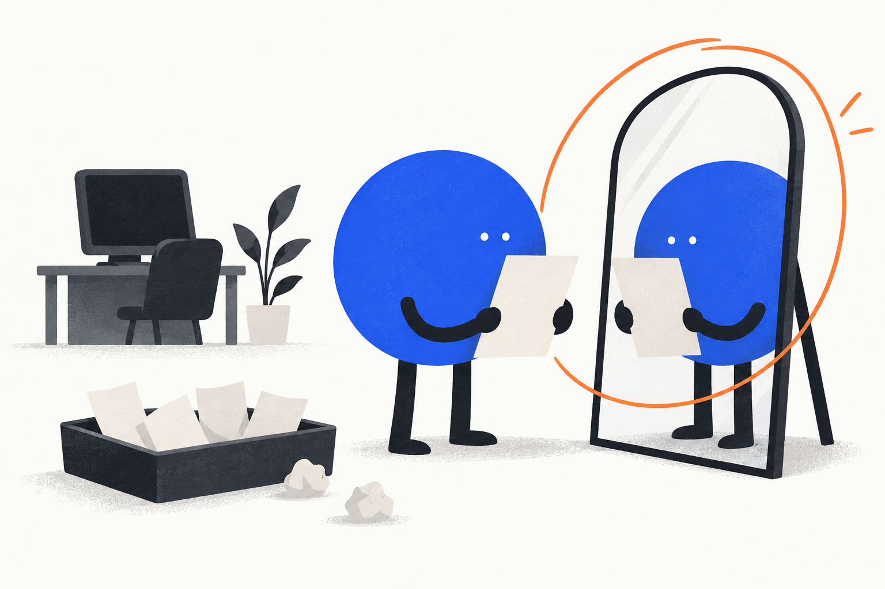
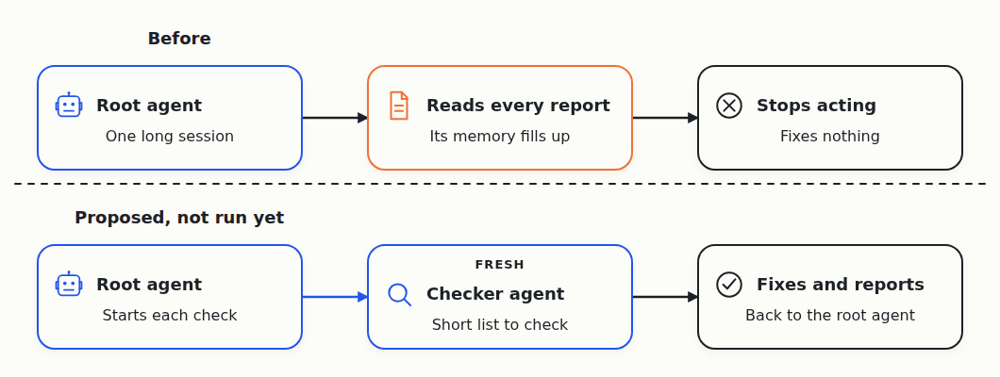
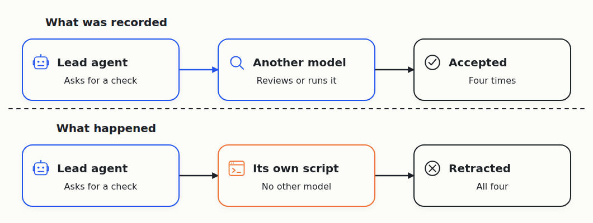
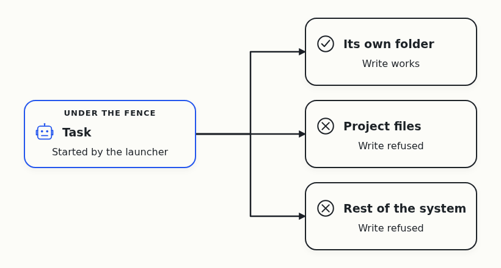
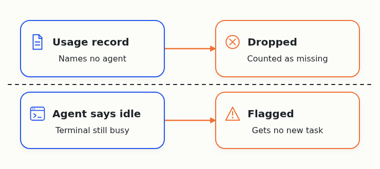
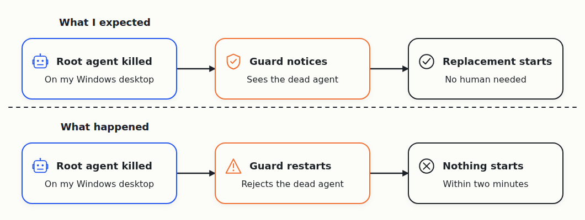
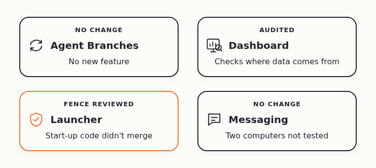
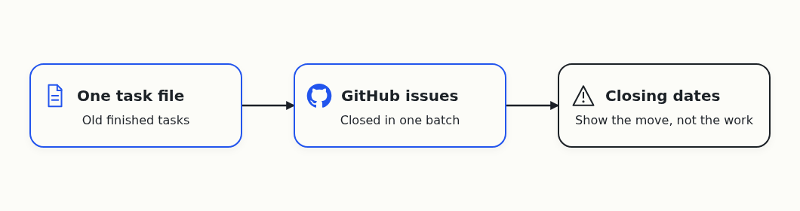
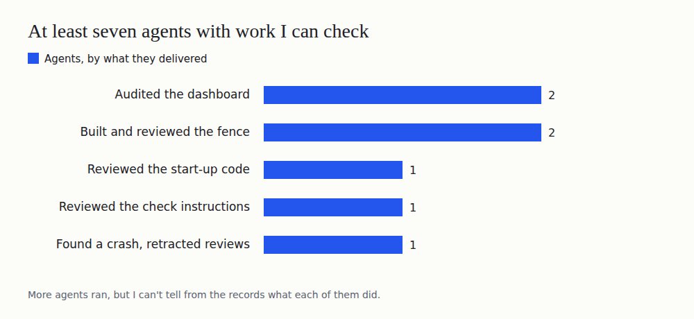

# Day 6: Reviews That Weren't Reviews, and a Killed Agent That Stayed Dead

On October 1, Cloudflare announced a [competition to build the next Git platform](https://blog.cloudflare.com/next-git-platform-on-cloudflare/). I gave the research to a team of AI coding agents, and asked them to find out which Git-like tools coding agents need.

I run into this problem myself. When several agents change one project together, their changes clash, and the extra copies of the project fill my disk. I want Git that works when many agents use it at the same time.

The agents work in four teams. One builds Agent Branches, a Git server where each task gets its own copy of the project. The others build a dashboard, a launcher that decides which agent starts next, and messaging between my desktop and my server.

Yesterday ended with a plan. A root agent, the one that watches all the others, should find what's broken and fix it without me.

## A fresh agent for every check

In the morning I saw the flaw in that plan. The root agent had run so long that its conversation was full of old reports, and it no longer acted on what it found.

So I [asked for a change](https://github.com/alexeygrigorev/cloudflare-agent-git/blob/main/_docs/founder-journal/2026-10-08.md). Every regular check should go to a fresh agent with a short list of what to look at. I picked GPT-6 Luna on its highest effort setting.

The agents [wrote the instructions](https://github.com/alexeygrigorev/cloudflare-agent-git/commit/dafaf6525fdc29a39b8750e40c0a74c02280929a), and a second agent reviewed them. Nobody has seen a fresh checker start on schedule and finish useful work yet.

## Reviews that weren't reviews

The launcher team worked on the code that starts a new agent, and on a fence that keeps each task inside its own folder.

The start-up code [passed its review](https://github.com/alexeygrigorev/cloudflare-agent-git/issues/102#issuecomment-6048984571): a reviewer on a different model ran every test on its own copy. Then the lead agent had another agent try it inside the current launcher. That run [failed with broken tests and a syntax error](https://github.com/alexeygrigorev/cloudflare-agent-git/issues/102#issuecomment-6053033610), so the agents held it back.

Next, the lead agent owned up to a mistake. It had recorded four results as reviews or test runs by other agents, but they came from its own scripts. The agents [retracted all four](https://github.com/alexeygrigorev/cloudflare-agent-git/issues/102#issuecomment-6053508313) and relabelled them as the lead agent's own tests.

The rule I took from it: a review counts only when I can name the second agent that did it.

Later another agent on the team built the fence. The launcher can now ask the operating system to refuse a task's writes outside its own folder. A reviewer on a different model [accepted the change](https://github.com/alexeygrigorev/cloudflare-agent-git/issues/102#issuecomment-6053807288).

The test was a small script, [not a real agent](https://github.com/alexeygrigorev/cloudflare-agent-git/issues/102#issuecomment-6053859898). Next, the fence becomes the default, and a real agent runs inside it.

## The dashboard checks where its numbers come from

I couldn't trust the dashboard's numbers, because some usage records didn't say which agent sent them.

Two agents on different models [audited the dashboard](https://github.com/alexeygrigorev/cloudflare-agent-git/commit/774211ea26af593755acb59660278653a60cc47e). One ran the checks, and the other repeated every step. They confirmed that the dashboard drops a record that doesn't name its agent or computer, and counts it as missing.

A second check catches an agent that says it's idle while its terminal is still busy, so it doesn't get a new task by mistake. All tests passed, including four built to catch a false idle report. The agents didn't change the page, and the day's usage numbers are still missing.

## Lost agents came back only by hand

In the morning one lead agent disappeared. This time the agents [found the cause](https://github.com/alexeygrigorev/cloudflare-agent-git/issues/102#issuecomment-6053361877): it hit its memory limit, and the system killed it. They brought it back from its saved conversation, by hand.

In the evening the agents recovered the main coordinating agent the same way, and it [replied and took its job back](https://github.com/alexeygrigorev/cloudflare-agent-git/issues/102#issuecomment-6067446831). Nobody has checked yet that it does useful work again.

Then I asked for the real test. The agents killed a new root agent on my Windows desktop on purpose. A guard program should have started a replacement.

The guard restarted, rejected the dead agent and stopped. Nothing came back within two minutes. The guard [has no way to start a successor](https://github.com/alexeygrigorev/cloudflare-agent-git/issues/102#issuecomment-6068136743) yet, so that's the next fix.

## Two products didn't move

Agent Branches got no new feature. Its last real trial is still [the one from the day before](https://github.com/alexeygrigorev/cloudflare-agent-git/commit/c53f57442b5ff40c9d26c9b47ecdf9b8676d7e4b). An agent sent its work to GitHub, and a reviewer restored it from a fresh copy.

Messaging between two computers didn't move either. In the morning, a check from the server couldn't reach my Windows desktop, so nobody knows what ran there.

## Task numbers

Task numbers for the day aren't available yet. When the agents moved the tasks into GitHub issues, they closed old finished tasks in one batch, so a chart of closing dates would mislead.

## Six days in

I wanted problems fixed without me. On this day the agents caught their own false claims and found the cause of one crash. But every lost agent still came back only by hand, and the one test of automatic recovery failed.

At least seven agents left work I can check. More ran, but the records mix workers, coordinators and background services. So I can't say how far I am from the fifty I'm aiming for, and the day's tokens and cost are unknown.

The next test is the same kill, after the guard learns to start a replacement. Until a lost agent comes back on its own, many agents working on one project without me is still out of reach.
