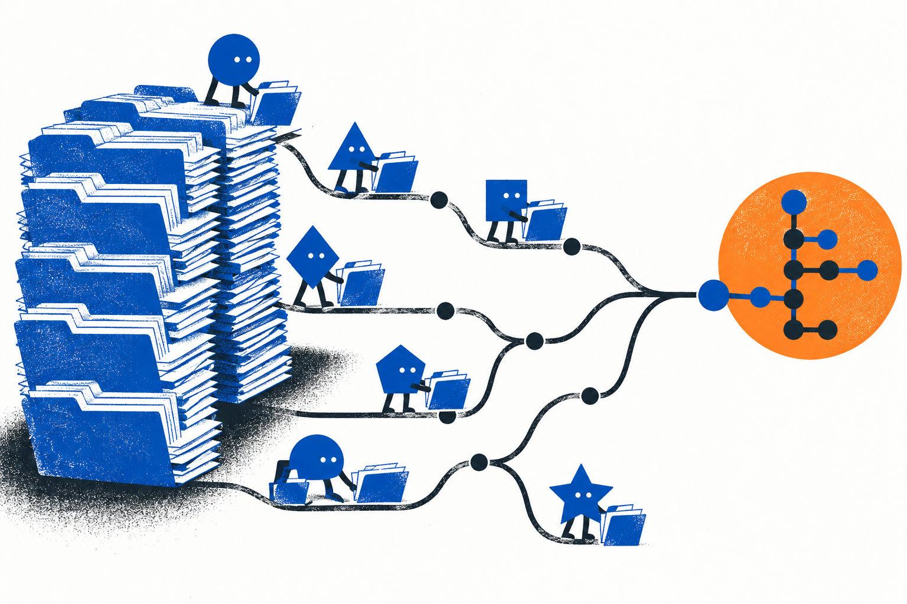
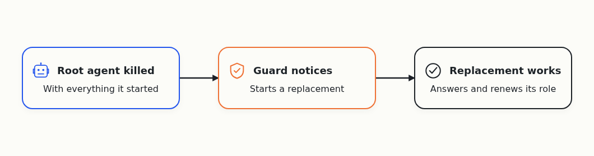
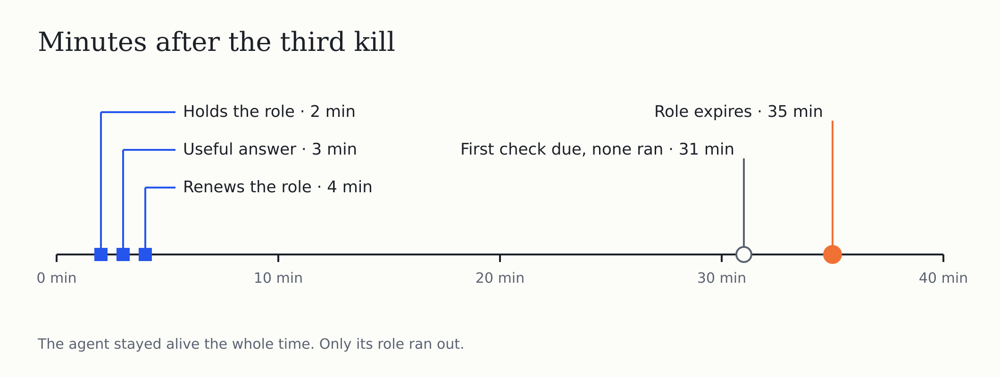
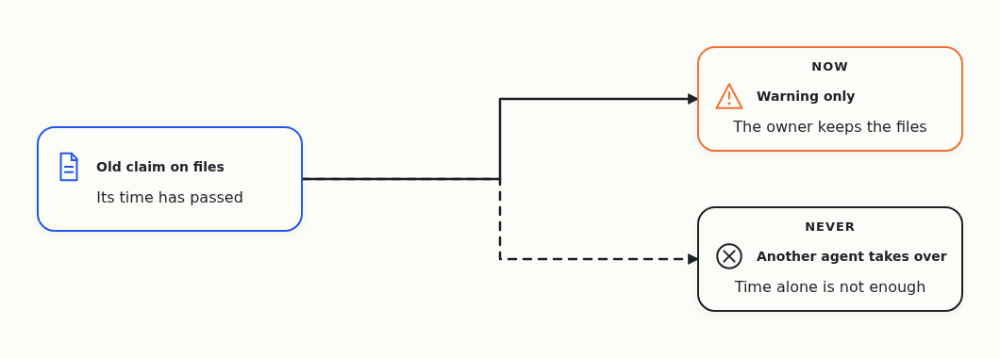
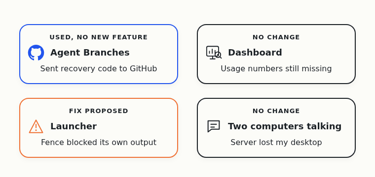

# A Killed Agent Came Back on Its Own, Then Lost Its Job

On October 1, Cloudflare announced a [competition to build the next Git platform](https://blog.cloudflare.com/next-git-platform-on-cloudflare/). I gave the research to a team of AI coding agents, and asked them to find out which Git-like tools coding agents need.

I run into this problem myself. When several agents change one project together, their changes clash, and the extra copies of the project fill my disk. I want Git that works when many agents use it at the same time.

The agents work in four teams. One builds Agent Branches, a Git server that gives each task its own copy of the project. The other three build a dashboard, a launcher and messaging between two computers. A root agent watches all of them.

In yesterday's test, the agents killed the root agent on my Windows desktop on purpose, and nothing brought it back.

## The third kill worked

Overnight the agents fixed what the first test had exposed. The guard, a small program that watches the root agent, learned to start a replacement.

In the next kill, a replacement did start. It answered, but it still looked busy after it finished, so it never took the role. The agents fixed that bug, and two files that differed only in Windows line endings.

Then they killed the root agent a third time, with everything it had started.

This time the replacement took over on its own. Within a few minutes it held the root role, gave a useful answer and renewed its role. Another agent [checked the result](https://github.com/alexeygrigorev/cloudflare-agent-git/issues/102#issuecomment-6071748457) and accepted it. Nobody helped by hand.

## Half an hour later, it lost its role

The root agent keeps its role only while it finishes a regular check every half hour. Nobody had installed that check yet.

So the first check never ran. The server refused to renew the role, which is the right behaviour, and [the role expired](https://github.com/alexeygrigorev/cloudflare-agent-git/issues/102#issuecomment-6072185519). The agent was still alive.

The guard also tried to recover, failed, and still reported that everything was under control.

The rule I took from it: coming back after a crash isn't recovery. The agent has to keep doing its job for hours, and the guard has to tell the truth when it can't help.

## Paid runs on hold, code backed up

I had asked for a fresh agent for each check, on GPT-6 Luna at its highest effort. The agents designed a way to start one and tested its limits. In a locked-down trial, the agent couldn't write in three places or start a helper agent, and nothing was spent.

Then the Codex account reached the reserve I keep, so the agents stopped starting new Codex runs. They didn't quietly switch the check to another model.

While they waited, the agents backed up [the incident write-up with the recovery code](https://github.com/alexeygrigorev/cloudflare-agent-git/blob/951f6621e52e3c353046db990969c7c9bc48ee57/_docs/incidents/2026-10-08-root-custody-outage.md) and [the Windows recovery code](https://github.com/alexeygrigorev/cloudflare-agent-git/blob/4ec6a7dd84d3e8fa0a01b2b4625f87027021cbab/recovery/root-accountability/win-source/README.md). A reviewer on a different model checked each for private data. Another agent restored both from a fresh copy of the repository. The first passed its tests there, and the second compiled.

Later that day [another batch of recovery code](https://github.com/alexeygrigorev/cloudflare-agent-git/issues/102#issuecomment-6078998600) went the same way. This backs up the code, not the running system.

## Smaller fixes

Each agent claims the files it edits. Before, a claim that went half an hour without renewal stopped blocking others, so another agent could commit over it. The agents [changed that](https://github.com/alexeygrigorev/cloudflare-agent-git/commit/a5d69b9bd6cd57fabc6081c34e97e9cb098c2c83): an old claim now only shows a warning, and the files still belong to their owner.

The check before each push looked at every file anyone had prepared in the shared copy, so one agent's unrelated files blocked another agent's push. Now it [looks only at what's pushed](https://github.com/alexeygrigorev/cloudflare-agent-git/commit/25dbf923bf615980c810f35a05c8a16f88bb5a9d).

An agent that waits for an answer also gets [a reminder typed into its own window](https://github.com/alexeygrigorev/cloudflare-agent-git/commit/888982bfdd182ffe0f24ba56ecc3e108743de560) when the answer is late. It has tests, but nobody has checked it on every machine.

## The four products

The agents sent every backup above to GitHub through Agent Branches, but the tool got no new feature. That's the team using its own tool, not customers.

The dashboard didn't change, and the day's usage numbers are still missing.

The launcher's fence from yesterday went too far. When a real agent ran inside it, the fence also [blocked the agent's own output folder](https://github.com/alexeygrigorev/agent-quota-launcher/issues/54#issuecomment-6066946456). The agent read its files but couldn't write its first result. A narrower fence is proposed and not tested yet.

Messaging between two computers didn't move. In the middle of a switch, the server [lost its route to my Windows desktop](https://github.com/alexeygrigorev/cloudflare-agent-git/issues/102#issuecomment-6078900960).

## Task numbers

Task numbers for this day aren't available. The issues show their state today, but not how they looked on this day.

## Seven days in

I want lost agents to come back without me. On this day one did. Then it lost its role, because the regular check that keeps it there doesn't exist yet.

At least three agents left work I can check. One on my Windows desktop wrote the recovery code, and a lead agent on the server tested and published it. A reviewer on Gemini checked a backup for private data. More ran, but the records don't say how many. The day's tokens and cost are unknown.

Before the next test, the agents have to install the regular check. Then they kill the root agent again and watch it work through at least two checks in a row. Until then, many agents working on one project without me is still out of reach.
