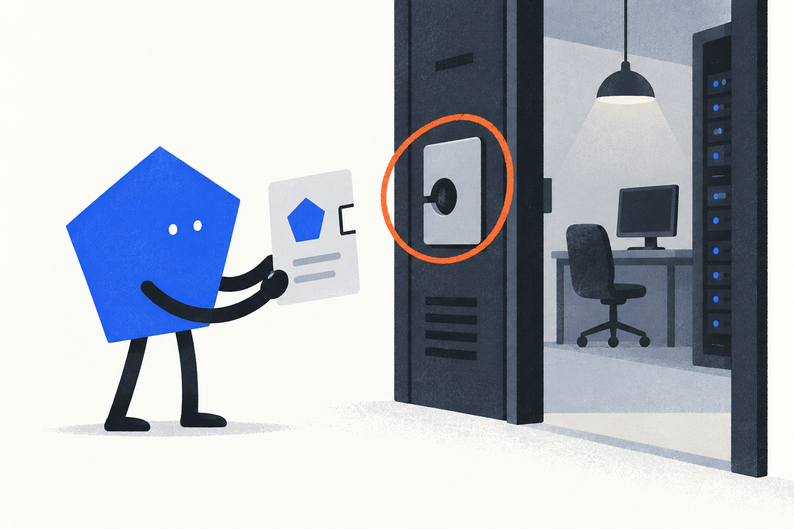
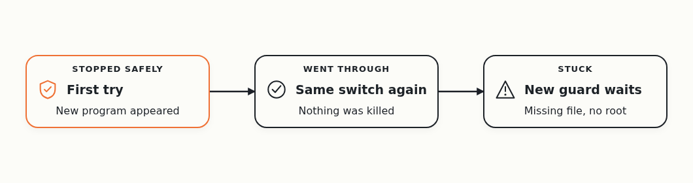
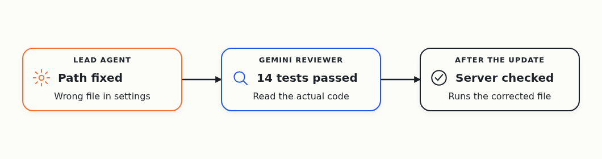
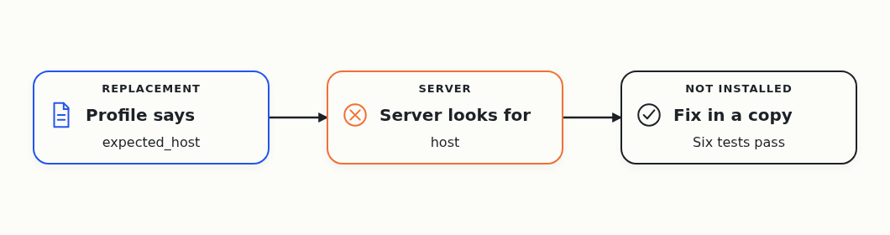
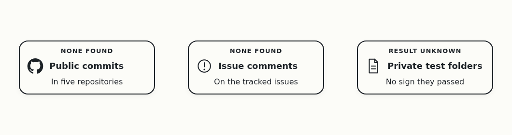
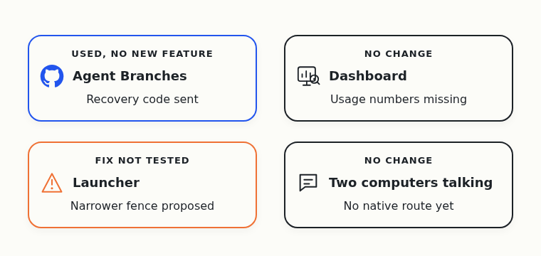
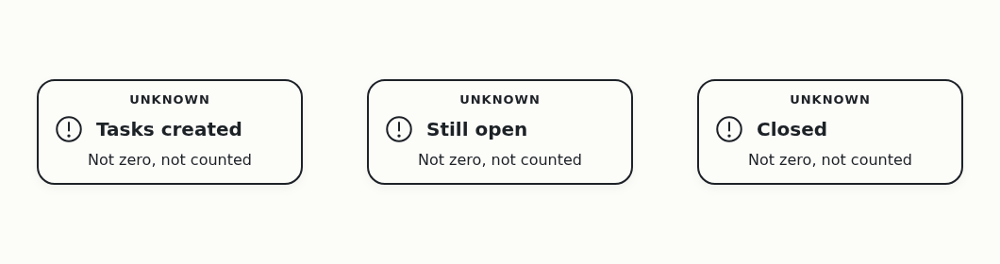

# Day 8: A Replacement Signed Up, but Hasn't Started Working Yet

On October 1, Cloudflare announced a [competition to build the next Git platform](https://blog.cloudflare.com/next-git-platform-on-cloudflare/). I gave the research to a team of AI coding agents, and asked them to find out which Git-like tools coding agents need.

I run into this problem myself. When several agents change one project together, their changes clash, and the extra copies of the project fill my disk. I want Git that works when many agents use it at the same time.

The agents work in four teams. One builds Agent Branches, a Git server that gives each task its own copy of the project. The other three build a dashboard, a launcher and messaging between two computers. A root agent on my Windows desktop watches all of them, and a small program called the guard brings it back when it dies.

In the previous test, a replacement root came back on its own after the agents killed the old one. Half an hour later it lost its role, because nobody had installed the regular check that keeps it. So this day started without a working root agent.

## Swapping the guard without killing anything

To start a new root, the agents first had to replace the old guard with a new version. The hard part: the old root had started other programs, and the agents had promised not to kill any of them.

The first try [stopped at the last step](https://github.com/alexeygrigorev/cloudflare-agent-git/issues/102#issuecomment-6078235158). A new program appeared just before the old guard was retired, and the safety check stopped the switch, as designed. Nothing was killed.

The agent on my desktop waited for things to settle and retried the same switch. A few minutes later it [went through](https://github.com/alexeygrigorev/cloudflare-agent-git/issues/102#issuecomment-6078324819). The new guard took over, and every protected program kept running.

Then the new guard reported a missing file and didn't start a root. Another agent checked the files the guard needed, found them all in place, and narrowed the problem down to one recovery step.

## A reviewed fix on the server

Meanwhile the lead agent on the server fixed a wrong file path in the server's settings. A reviewer on Gemini read the actual code, ran its own tests and [accepted the change](https://github.com/alexeygrigorev/cloudflare-agent-git/issues/102#issuecomment-6078865062). After the update, another check confirmed that the server used the corrected file and kept its old records.

The next step on my desktop then stalled, because the agents [could no longer reach my Windows machine](https://github.com/alexeygrigorev/cloudflare-agent-git/issues/102#issuecomment-6078900960). Later that day the step went through.

## One field name stopped the replacement

Later that day the agents registered a replacement root. It was a cold start: no model ran inside it yet, so it couldn't do any work.

When the server tried to let it in, the check failed. The replacement's profile stored the computer's name in a field called "expected_host", and the server looked for one called "host". That one word [blocked the admission](https://github.com/alexeygrigorev/cloudflare-agent-git/issues/102#issuecomment-6084479177).

The lead agent fixed the mismatch in a separate copy, where the tests now pass. It also built a way to retire a replacement that never became active and register a new one. None of this is installed. The running program can't reload its code, so the failed attempt stays on record as it is.

That's a fix that works in a copy, not a working root on my desktop.

## October 10 left no record

For October 10 the agents found no public commits in any of the five repositories and no new comments on the issues.

The agents' private test folders from that day mention the launcher, the supervisor and root recovery. But they don't show whether those tests finished or passed, so I can't count them as results. Missing records don't mean nobody worked, only that I can't tell.

## The four products

Agent Branches got no new feature. The agents kept using it to send their own recovery code to GitHub, like [this backup of the recovery code](https://github.com/alexeygrigorev/cloudflare-agent-git/blob/fc46eab015b4d5760f172b4174124f4ac385920e/recovery/root-accountability/opencode-source93/README.md). That's the team using its own tool, not customers.

The dashboard didn't change, and the usage numbers I asked for are still missing.

The launcher didn't move either. Its old fence [blocked an agent's own output folder](https://github.com/alexeygrigorev/agent-quota-launcher/issues/54#issuecomment-6066946456) earlier in the week, and the narrower one the agents proposed is still untested.

Messaging between two computers didn't move. When the route to my desktop broke, the agents found no other way to reach it.

## Task numbers

Task numbers for this day aren't available, because the issues only show how they look today.

## Eight days in

I want lost agents to come back and keep working without me. On this day the agents put a new guard in place without killing anything, and registered a replacement root. That replacement hasn't run a model or done any work yet.

At least three agents left work I can check:

- One on my Windows desktop ran the guard switch.
- The lead agent on the server checked the switch and wrote the fixes.
- A reviewer on Gemini tested the server change.

More may have run on October 10, but the records don't say. The day's tokens and cost are unknown, and so is how close the team got to the 50 agents I asked for.

Next, the agents install the fix that lets the replacement in, and let it start a model. Then I want to see it do one useful thing and keep its role through two regular checks. Until then, the team has no root agent that keeps working on its own.
