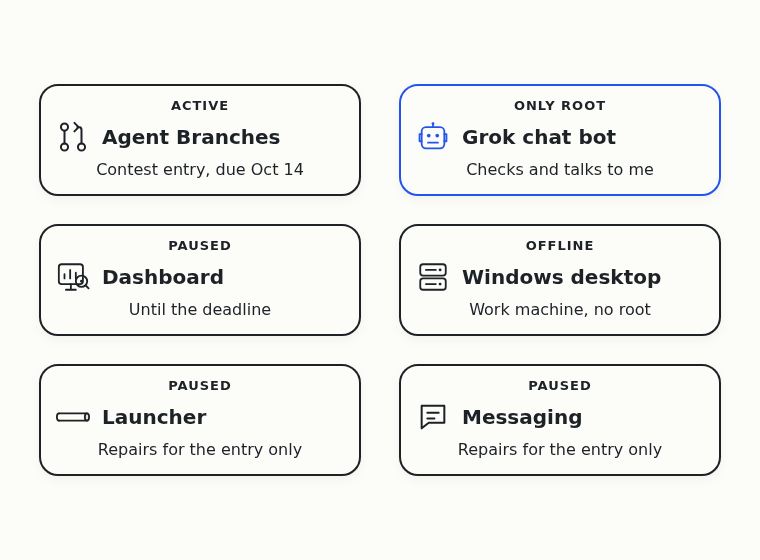
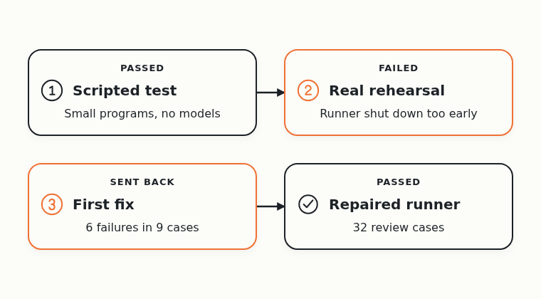
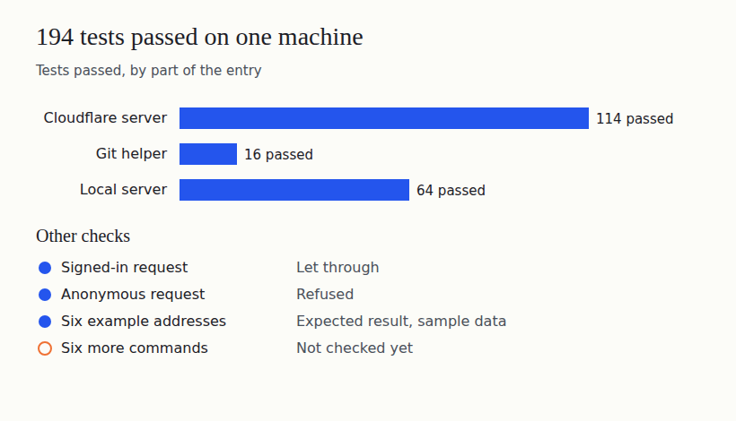
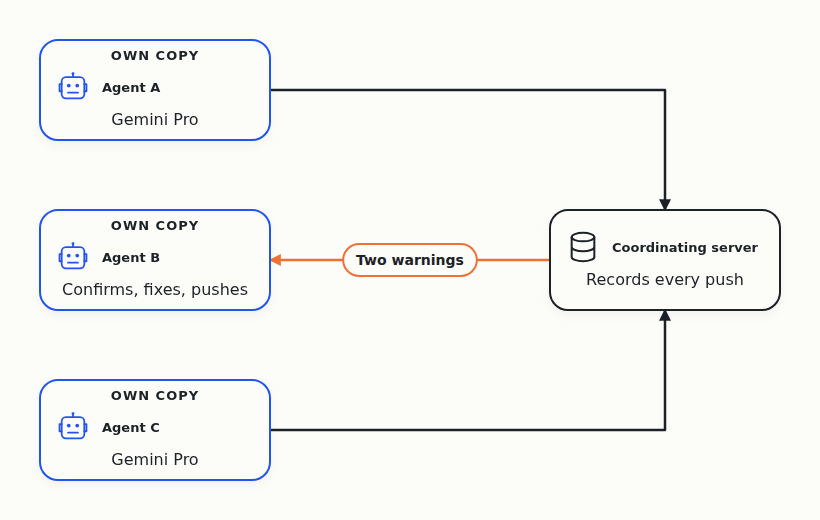
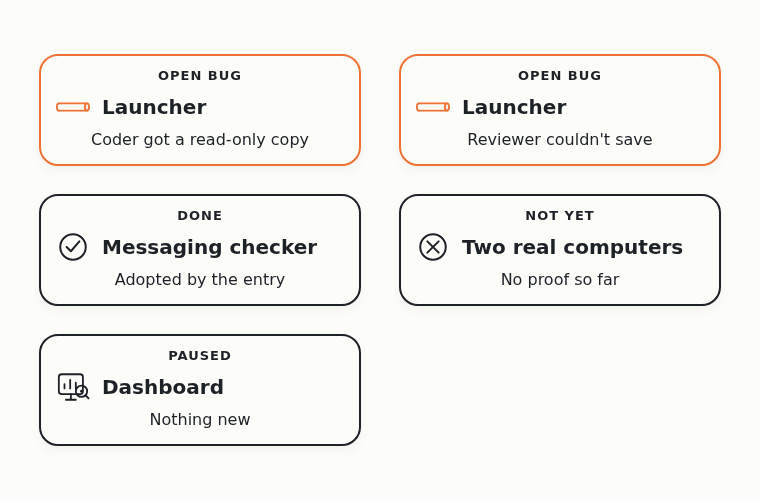
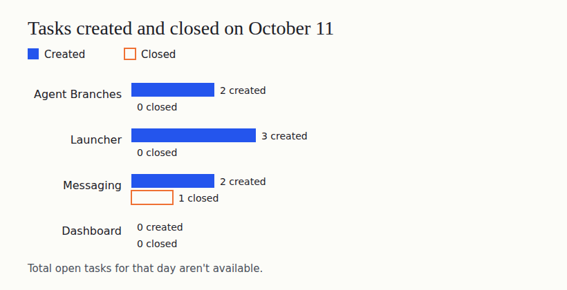

# All In on the Contest Entry. Real Agents Shared It on One Machine

On October 1, Cloudflare announced a [competition to build the next Git platform](https://blog.cloudflare.com/next-git-platform-on-cloudflare/). I gave the research to a team of AI coding agents. Their job is to find out which Git-like tools coding agents need.

I hit this problem myself. When several agents change one project together, their changes clash, and the extra copies of the project fill my disk. I want Git that works when many agents use it at the same time.

I call the agent that checks on the others and talks to me the root. The day before, a replacement root agent had signed up but hadn't done any work. On Sunday I stopped waiting for it and changed the plan.

## One product until the deadline

The contest deadline is October 14. So I [narrowed the work](https://github.com/alexeygrigorev/cloudflare-agent-git/blob/b4a261b6e17202b62e3e3454d2cf8858413e7b62/_docs/founder-journal/2026-10-11.md) to the contest entry, Agent Branches. It's a Git server that gives each agent task its own copy of the project. The dashboard, the launcher and the messaging work are paused until then, apart from repairs the entry depends on.

I made my Grok chat bot the only root. At first I called the root on my Windows desktop retired, which was wrong. The desktop is just offline while I'm away, and it stays on the team as a work machine. Its root role [stood down](https://github.com/alexeygrigorev/cloudflare-agent-git/commit/b4a261b6e17202b62e3e3454d2cf8858413e7b62), so two roots can't compete.

The agents also sent 35 older commits from October 8 to GitHub. That's earlier research arriving late, not new work. Nothing goes to Cloudflare and nothing costs money without the root's explicit message. My whole cloud budget is $5 a month, including the base fee Cloudflare already charges.

## A scripted test passed, then the real rehearsal failed

For the demo, agents need to change one project at the same time. The agents started with a scripted version, where small programs stand in for real models. After a repair, a reviewer on Gemini Flash [approved it](https://github.com/alexeygrigorev/agent-branches/issues/53#issuecomment-6108854464). In each clean run, the scripted clients pushed their changes to the server at overlapping moments. A push is how Git sends changes to a server.

Then came a rehearsal with real models, and it [failed](https://github.com/alexeygrigorev/agent-branches/issues/53#issuecomment-6111786489). A small program called the runner starts the server and gives the agents their tasks. This time it shut the server down while the tasks were still waiting to start. Three agents later finished their work, but two pushes hit a closed server, and the third left no record of a successful push.

The lead agent asked one agent to make the runner wait for its tasks and another to correct the instructions. A separate reviewer then [found six failures in nine cases](https://github.com/alexeygrigorev/agent-branches/issues/53#issuecomment-6112402866), so the first fix went back for repair.

## The run instructions work on one machine

Meanwhile, the agents checked the documented commands. The full test command [passed 194 tests](https://github.com/alexeygrigorev/agent-branches/issues/53#issuecomment-6113003245). Earlier attempts had failed on a read-only cache and a thread limit.

Six example addresses returned what they should, using sample data. Six more commands from the instructions were still unchecked.

## Three agents worked at the same time

The repaired runner passed 32 review cases and [went to GitHub](https://github.com/alexeygrigorev/cloudflare-agent-git/commit/7a96fd17b173794d8dde6d92fbebd6fd050581a0). Then [three real agents worked at the same time](https://github.com/alexeygrigorev/agent-branches/issues/53#issuecomment-6113441511), each in its own copy of the project. All three finished, and their pushes matched what the server recorded.

All three ran the same Gemini Pro model on one server. That proves the flow on one machine, not across three providers or two computers.

The server raised two clash warnings, and at first nobody confirmed them. Then [agent B confirmed both](https://github.com/alexeygrigorev/agent-branches/issues/53#issuecomment-6113990757), corrected its earlier claim that it saw no warnings, fixed its code and pushed again.

Each pair of agents' work, checked together, passed its tests on the second try, after the first round failed on an empty Git repository. The code is [on GitHub](https://github.com/alexeygrigorev/cloudflare-agent-git/commit/76cc37825aded976b40420e107140468691f57ea), but a final review of the whole run was still open that night.

## Paused work still turned up problems

While working on the entry, the agents hit two launcher bugs, and both stay open. An agent meant to write code [got a read-only copy](https://github.com/alexeygrigorev/agent-quota-launcher/issues/57), and a reviewer [couldn't save its report](https://github.com/alexeygrigorev/agent-quota-launcher/issues/58). The agents worked around both with a different setup.

The messaging team finished a checker that tells the entry whether its demo evidence is complete, and the entry [adopted it](https://github.com/alexeygrigorev/agent-coordination/issues/60#issuecomment-6109240366). Each result still reports that proof from two real computers is missing. The dashboard had nothing new.

## The task tracker

Across the four trackers, seven tasks opened on Sunday, and only the messaging checker closed, so the rest stayed open. The total number of open tasks for that day isn't available.

## Nine days in

At least six agents left work I can check:

- Three agents on Gemini Pro worked on the entry at the same time
- The lead agent ran the checks and put the reviewed code on GitHub
- A reviewer on Gemini Flash approved the scripted test
- The messaging lead finished the evidence checker

Nobody knows how much the other agents did, or the day's tokens and cost.

Bringing back a lost agent without me is [still an open task](https://github.com/alexeygrigorev/cloudflare-agent-git/issues/102). The code exists, but nobody has shown it working on its own.

Real agents now share the entry on one machine, and the server catches their clashes. Next comes the final review of the whole run, a repair of the test checker, the demo video and two real computers. Three days remain.
