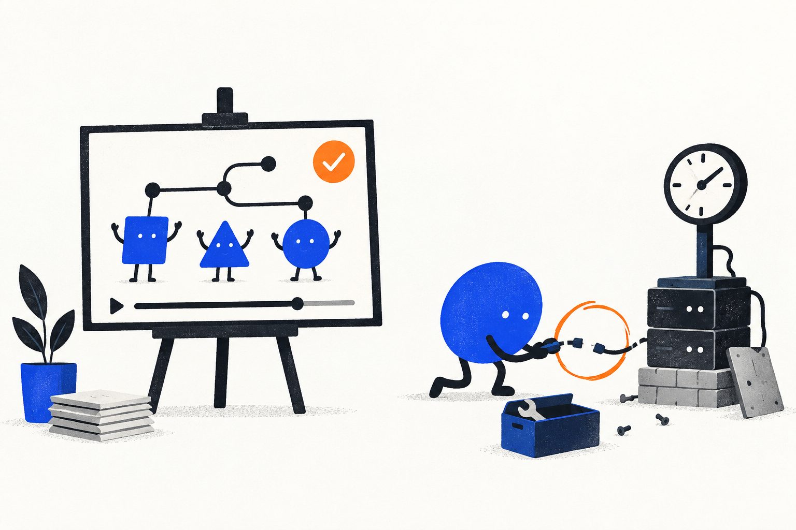
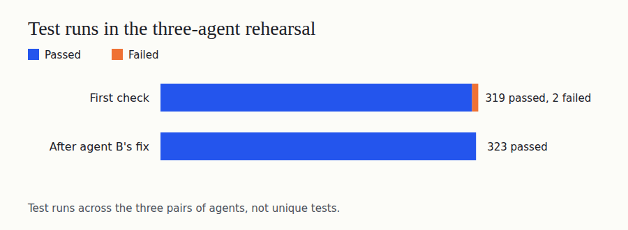
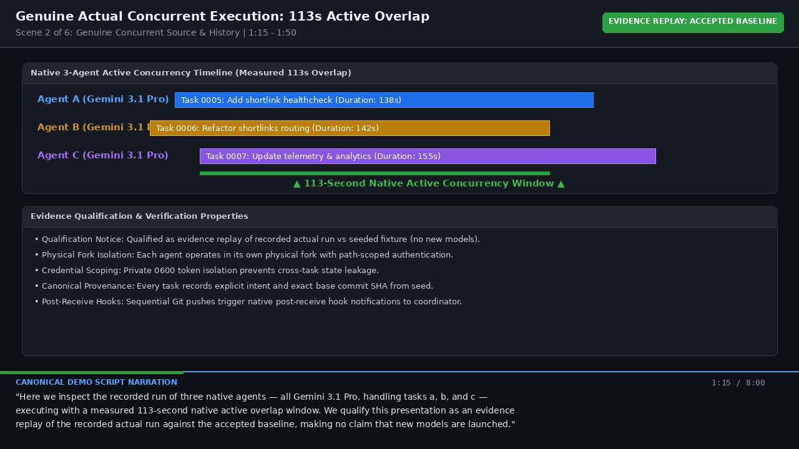
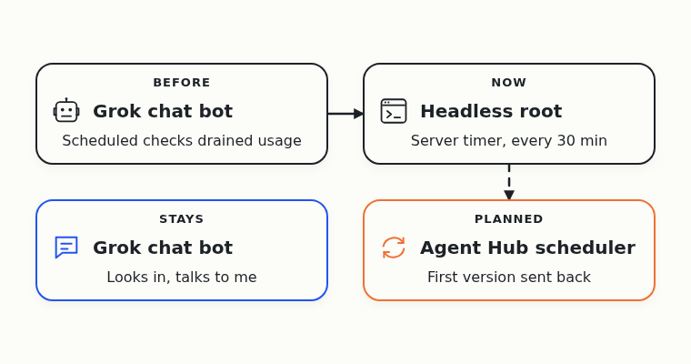
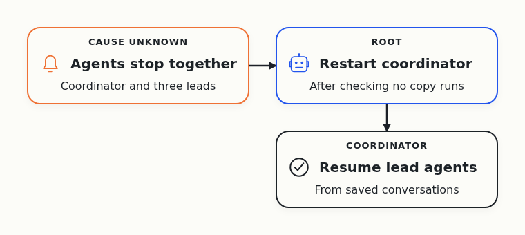
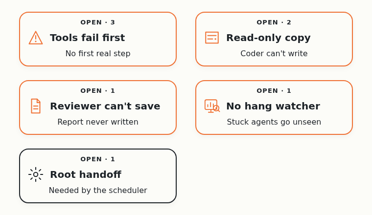
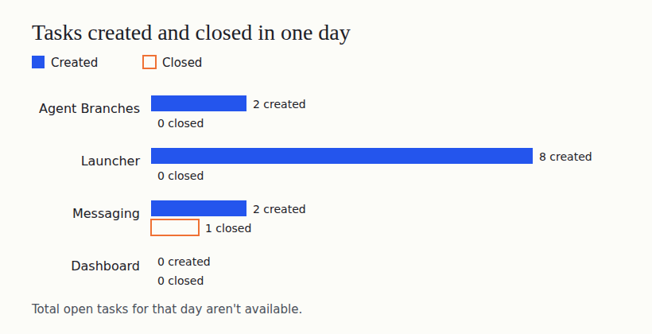

# Day 10: The Demo Video Is Approved. The Agents Around It Are Still Fragile

On October 1, Cloudflare announced a [competition to build the next Git platform](https://blog.cloudflare.com/next-git-platform-on-cloudflare/). I gave the research to a team of AI coding agents. Their job is to find out which Git-like tools coding agents need.

I hit this problem myself. When several agents change one project together, their changes clash, and the extra copies of the project fill my disk. I want Git that works when many agents use it at the same time.

On Sunday, three real agents worked on the contest entry, Agent Branches, at the same time on one machine. It's a Git server that gives each agent task its own copy of the project. Its final review was still open.

## The three-agent run passed review

Overnight, a separate reviewing agent [accepted the whole run](https://github.com/alexeygrigorev/agent-branches/issues/53#issuecomment-6115851621). The first check had found two failing tests. Agent B, whose code caused them, confirmed both warnings before it pushed a fix. After that, every test passed.

In the same run, a test report arrived for an outdated version of the project. The server refused it and kept its records unchanged, so an old result can't mark new work as safe.

All three agents ran the same Gemini Pro model on one server. So I know the flow works on one machine, not across providers or two computers. The lead agent put the [accepted code on GitHub](https://github.com/alexeygrigorev/cloudflare-agent-git/commit/d215e9b7ba5e58dcbd041494641fc383a50b0427) and checked that a fresh copy restored every file.

## I approved the demo video

The agents turned the recorded run into an [eight-minute demo video](https://github.com/alexeygrigorev/cloudflare-agent-git/blob/7459ff4ab03dafe8ccd7a8e5f0502869caee1a48/docs-submission/videos/agent-branches-demo-draft.mp4). Separate reviewers checked it for private data and accuracy, and sent back a wrong account of the two failing tests.

Early on Monday I approved the video and froze it. It replays the recorded run, labels sample data as sample data and shows nothing running on Cloudflare.

Approving the video isn't submitting the entry. The contest form is mine to fill in, and I haven't done it yet.

## The root moved off my chat bot

I call the agent that checks on the other agents and talks to me the root. On Sunday I switched the root to my Grok chat bot. It was great, but its regular checks were draining my usage. So I switched to headless roots: agents that start fresh each time, do one round of work and exit.

On Monday morning the agents [installed a stopgap version](https://github.com/alexeygrigorev/cloudflare-agent-git/commit/7bbf9f55bd403b2245366b4e83bb3115902de20f). A timer on my server starts a fresh Codex session every half hour. Each run takes a lock, so a new run skips while a healthy one works and takes over from a stuck one. The Grok bot still looks in and stays my contact.

Later, a scheduler in Agent Hub, a coordination service the agents are building, should start the root on any free machine. A reviewer [sent its first version back](https://github.com/alexeygrigorev/agent-hub/issues/6#issuecomment-6118271163), because a machine could take over the root before checking that it could run one.

The agents are repairing that now. Nobody has measured how much usage the switch saves.

## A crash took down the lead agents

On Monday morning, the coordinating agent and the three lead agents all stopped at the same moment. The root checked that no copy of the coordinating agent was still running and restarted it. That agent [resumed the lead agents](https://github.com/alexeygrigorev/cloudflare-agent-git/issues/102#issuecomment-6120247296) from their saved conversations, and the contest work went on.

Nobody knows yet why they crashed. The server was swapping heavily, but that's a guess, not a cause.

Later, a task agent ran a command that stops programs by name across the whole server. A safety guard should have blocked it, but the agent's setup had lost the guard. The coordinating agent stopped that task and paused launches of that kind until a reviewed fix is in place.

Bringing back a lost agent without another agent's help is [still an open task](https://github.com/alexeygrigorev/cloudflare-agent-git/issues/102).

## Paused work still broke

The launcher starts agents within my quota limits. It's paused apart from repairs the entry needs, yet the agents opened eight bugs in it in one day, and all of them stay open.

In one, an agent's [tools failed before it produced anything](https://github.com/alexeygrigorev/agent-quota-launcher/issues/60). In another, a reviewer [kept retrying a tool its model doesn't support](https://github.com/alexeygrigorev/agent-quota-launcher/issues/61). A [watcher that spots hung agents](https://github.com/alexeygrigorev/agent-quota-launcher/issues/62) doesn't exist yet.

The messaging team builds a way for agents on my laptop, my server and my Windows desktop to message each other. Two real computers still haven't talked, because my desktop is offline while I'm away. That test waits until the desktop is back on. The dashboard had nothing new either.

## The task tracker

Across the four trackers, twelve tasks opened in the past day and one closed. The total number of open tasks isn't available.

The closed task was the messaging team's checker for demo evidence. It still reports that proof from two real computers is missing.

## Ten days in

At least seven agents left work I can check:

- Three Gemini Pro agents did the rehearsal, and agent B fixed its clash
- The entry's lead agent put the accepted run and the video on GitHub
- Separate reviewers accepted the run, passed the video and sent the first scheduler back
- The Grok bot root installed the timer and restarted the coordinating agent
- The coordinating agent resumed the lead agents and stopped the unsafe task

Nobody knows how much the other agents did, or the day's tokens and cost.

The entry is close: the run passed review, and the video is frozen. But after a crash, another agent still has to restart the rest, and the launcher stops some agents before their first step.

With two days left, tomorrow's test is whether the headless root keeps the agents moving for a full day without the chat bot's checks.
