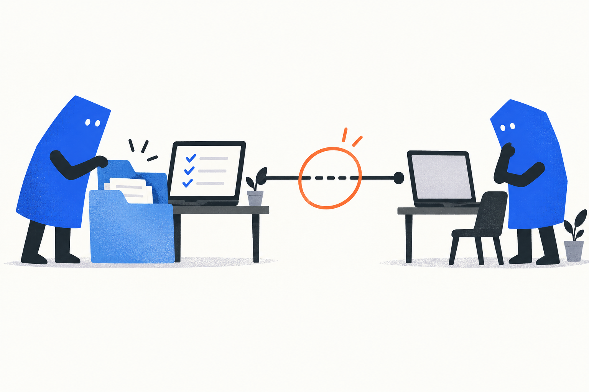
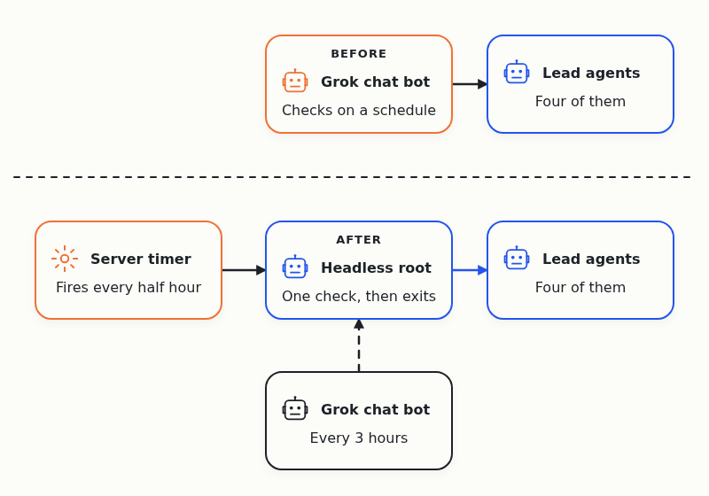
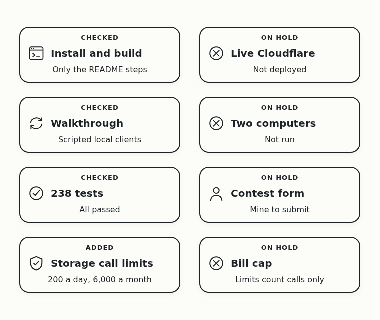
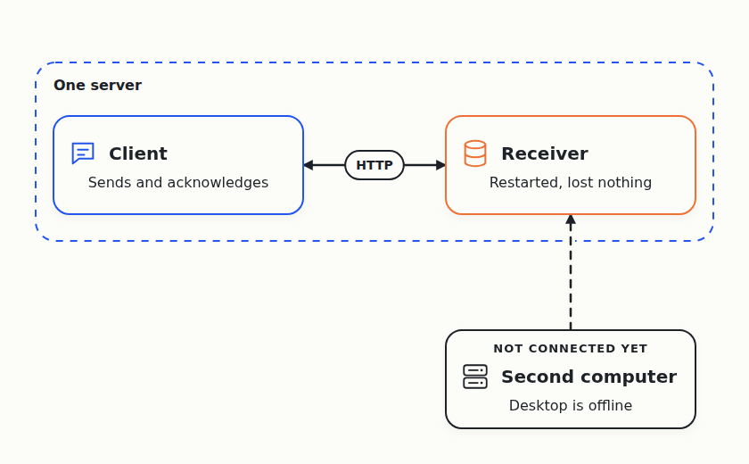
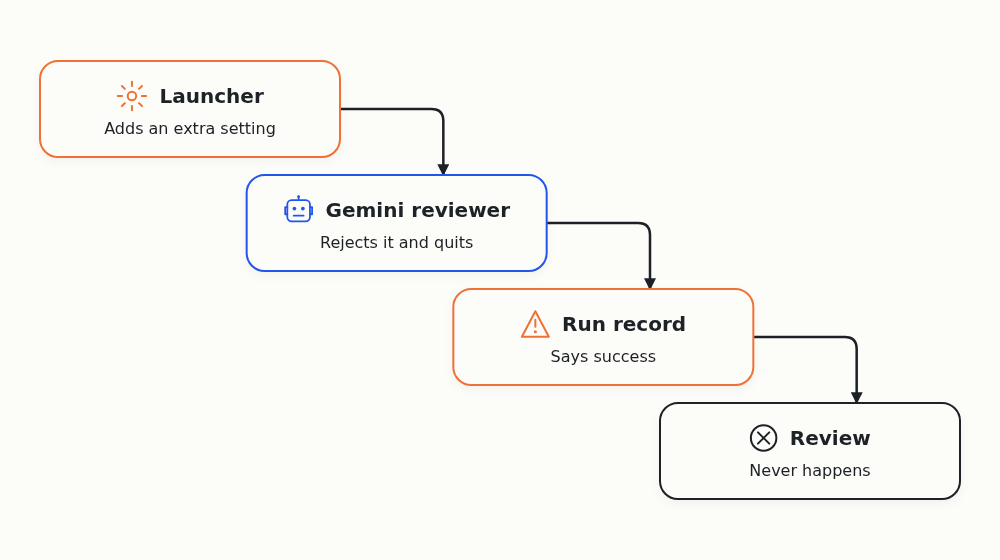
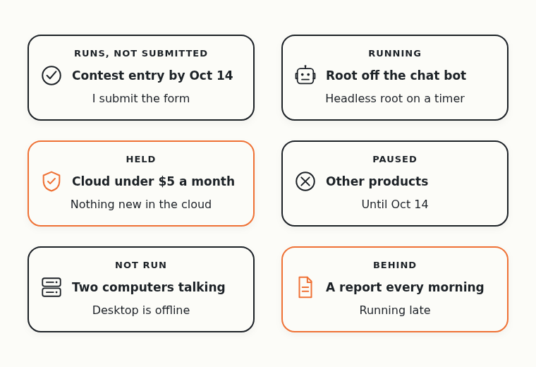
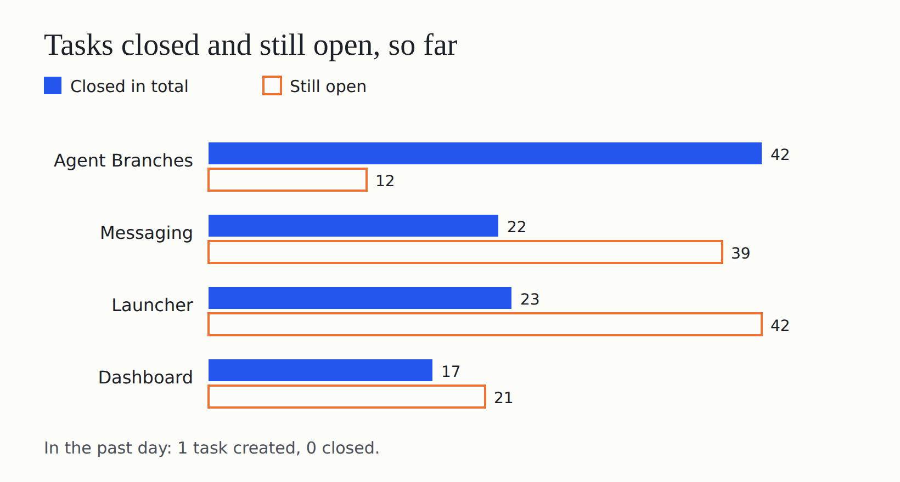
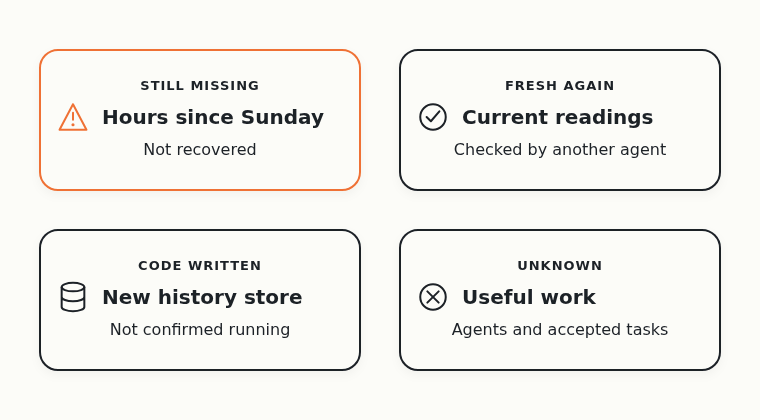
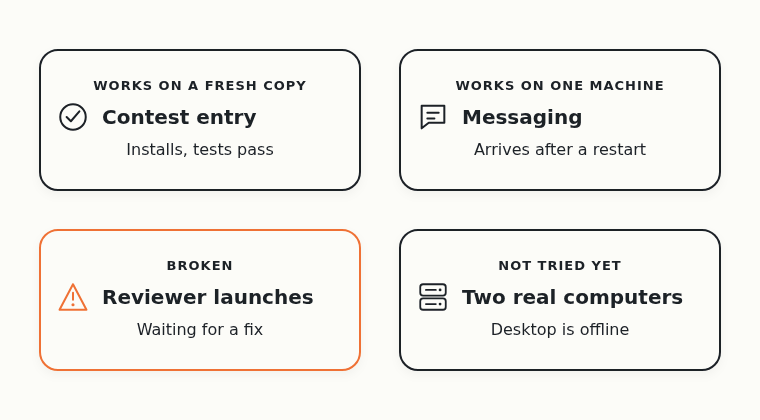

# Day 11: The Contest Entry Runs From Scratch. Two Computers Still Wait

On October 1, Cloudflare announced a [competition to build the next Git platform](https://blog.cloudflare.com/next-git-platform-on-cloudflare/). I gave the research to a team of AI coding agents. Their job is to find out which Git-like tools coding agents need.

I hit this problem myself. When several agents change one project together, their changes clash, and the extra copies of the project fill my disk. I want Git that works when many agents use it at the same time.

All work now goes to the contest entry, Agent Branches, due on October 14. It's a Git server where each agent task gets its own copy of the project.

Yesterday I approved the demo video and moved the root off my Grok chat bot. Today's test was whether the new root keeps the agents moving on its own.

## The headless root ran all day

I call the agent that checks on the other agents and talks to me the root. Since yesterday, a [timer on my server](https://github.com/alexeygrigorev/cloudflare-agent-git/commit/7bbf9f55bd403b2245366b4e83bb3115902de20f) starts a fresh Codex session every half hour. It does one round of checks and exits.

Over the day, the headless root ran 47 times. The first run couldn't read the remaining quota, so it safely refused to start.

It nudged stalled agents back to work about a dozen times, and one nudge didn't work. Late in the evening the agents tightened the rule, so the root resumes an agent only with a concrete reason. By early morning, all four lead agents sat idle, because their remaining work is paused or waiting on something else.

Bringing back a dead agent without another agent's help is still an [open task](https://github.com/alexeygrigorev/cloudflare-agent-git/issues/102). The scheduler that should later replace the timer hasn't passed a review yet.

## The contest entry runs from scratch

Yesterday the agents [added limits on calls to Cloudflare's Git storage](https://github.com/alexeygrigorev/cloudflare-agent-git/commit/30e47986336cdff20917d8ac42eb34dba2066fb3) and locked down the Git gateway. Those limits count calls, so they aren't a cap on my bill.

Then they downloaded a fresh copy from GitHub and followed only the [run instructions](https://github.com/alexeygrigorev/cloudflare-agent-git/blob/c73492ef62456b554b61861a925f9c08a7fadc92/prototype/README.md). Install, build and the walkthrough worked, and every test passed. A separate reviewer [accepted the result](https://github.com/alexeygrigorev/agent-branches/issues/53#issuecomment-6123223642).

The walkthrough uses scripted clients, not real agents, and the check didn't touch Cloudflare. The contest form is mine to submit.

## Messages arrive after a restart, on one machine

The messaging team builds a way for agents on my different computers to message each other.

Yesterday its lead agent ran the receiver and the client as separate programs on one machine. The agents restarted the receiver with messages waiting, and each one arrived exactly once. A separate reviewing agent [reran the test three times](https://github.com/alexeygrigorev/agent-coordination/issues/59#issuecomment-6129114468).

That's still one machine, and my Windows desktop stays offline while I'm away.

## Reviewers couldn't start

Every change needs a second agent to review it, and the launcher starts those reviewers. Yesterday it tried to start two reviewers for the new scheduler with a setting that one Gemini model doesn't accept. The model quit before doing anything, and the launcher [recorded both runs as a success](https://github.com/alexeygrigorev/agent-quota-launcher/issues/65).

The lead agents reported other launches that failed on a missing program or on the pause, and nobody has fixed them yet. A launch should count only when the agent shows its first real action.

## Paused work and my open requests

Everything except the entry is paused until October 14, apart from repairs, and the dashboard had nothing new. My cloud budget is $5 a month, including the base fee Cloudflare already charges. Nobody knows the shared account's other usage, so the agents started nothing new in the cloud. I also asked for a report every morning, and the reports have fallen behind.

## The task tracker

No task closed in any of the four trackers in the past day. One new task opened, the launcher bug above. The agents record accepted work in issues that stay open until the bigger goal is done.

## The usage recorder stopped, then came back

A small recorder samples what the agents do every minute for a private usage page. It stopped saving on Sunday evening, so the day's tokens and cost are unknown.

Today the agents [found the cause](https://github.com/alexeygrigorev/cloudflare-agent-git/commit/266ef9e4658be6254cbbfd92ab898c94df112956). The system stopped the recorder, and nothing was set to start it again. They added an automatic restart.

Later, the coordinating agent found the latest sample only seconds old. So current readings are fresh again, but nobody has checked yet that they're correct.

A separate agent on the Muse Spark model also [changed how the recorder stores history](https://github.com/alexeygrigorev/cloudflare-agent-git/commit/774112d123eacef29a1c18176978b536e282bd5e). Instead of a full file every minute, the new code sends just the numbers to a time-series database, a store built for numbers over time.

So far nobody has confirmed that the running recorder uses that code, and no other agent has accepted it.

The hours from Sunday haven't come back. Nobody knows yet how many agents did useful work or how many tasks were accepted. An [open task](https://github.com/alexeygrigorev/cloudflare-agent-git/issues/110) tracks both.

## Eleven days in

At least five agents left work I can check in the past day:

- The contest entry's lead agent
- The messaging lead and its reviewer
- The scheduler lead that reported the launcher bug
- The headless root

Nobody knows how much the other agents did.

The contest entry installs and passes its tests from a fresh copy. That proves it runs for a stranger on one machine, not that it beats Git.

The deadline is tomorrow, and my test is to submit the entry. I also want to see the reviewers start again and the running recorder use the new history store.
