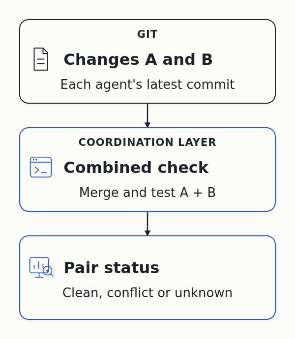
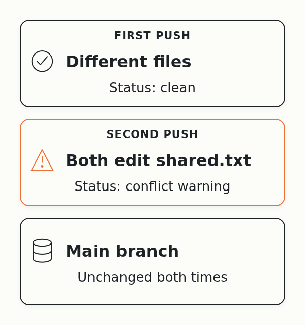
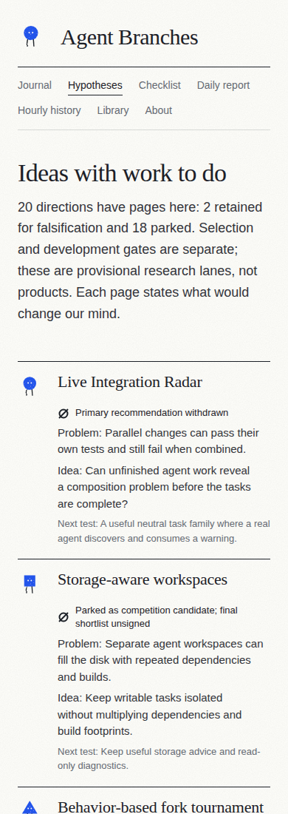
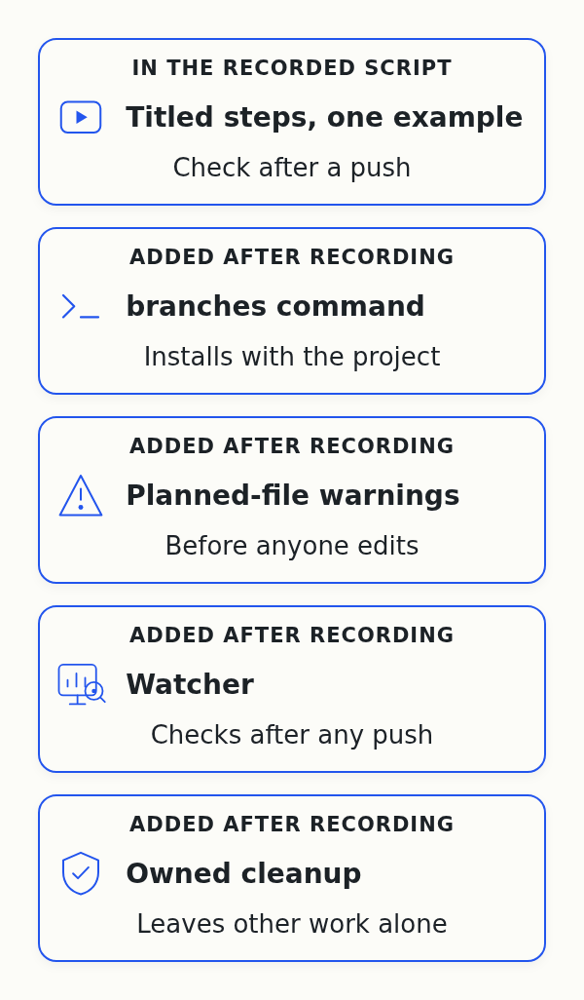
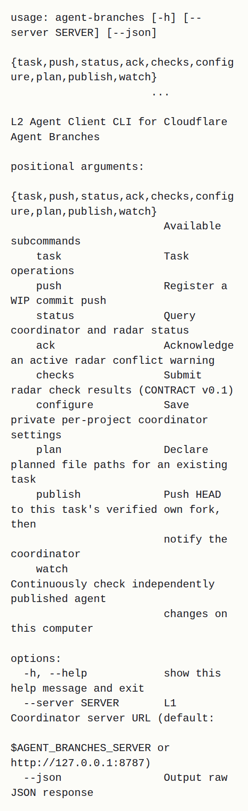
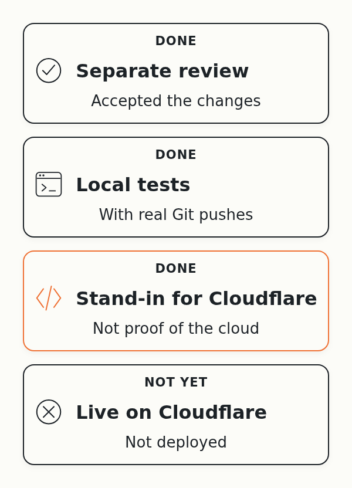
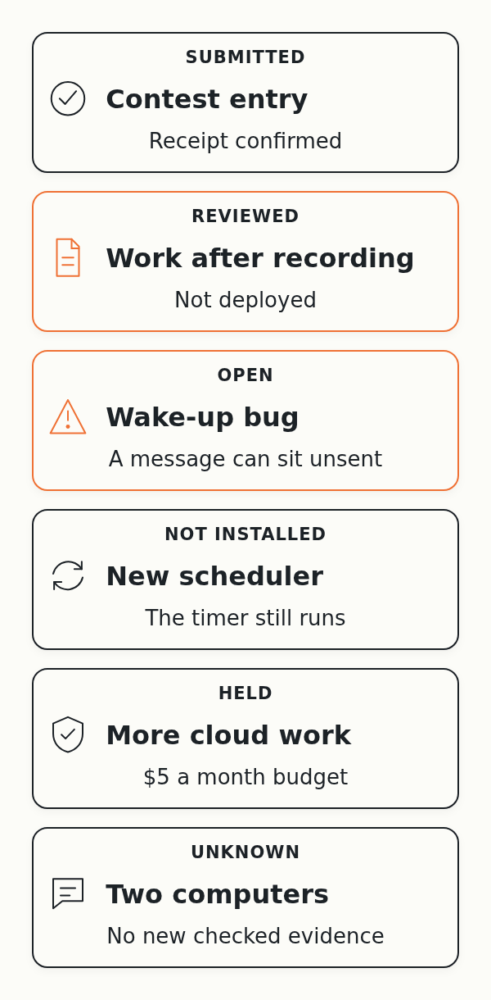
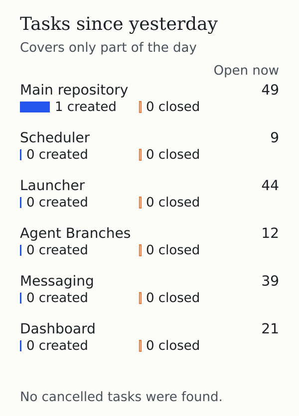
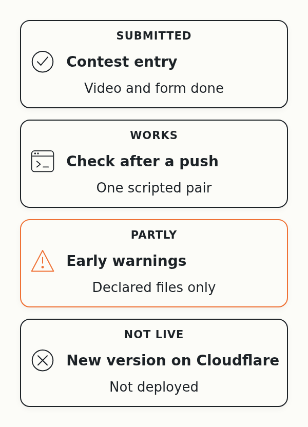

# Day 13: The Entry Is In. The Agents Kept Building After the Recording

On October 1, Cloudflare announced a [competition to build the next Git platform](https://blog.cloudflare.com/next-git-platform-on-cloudflare/). I gave the research to a team of AI coding agents. Their job is to find out which Git-like tools coding agents need.

I hit this problem myself. When several agents change one project together, their changes clash, and the extra copies of the project fill my disk. I want Git that works when many agents use it at the same time.

The contest entry, Agent Branches, is a Git server where each agent task gets its own copy of the project. On October 13, its full test passed live on Cloudflare, and the form was mine to submit. Since then I've recorded the demo and submitted the entry.

## Plain Git can already do that

In the first version of the demo, two scripted agents pushed changes, and the demo merged them and ran the tests. I had one objection: plain Git can already do that.

So I changed how I explain the project. I'm not building a better Git, I'm building a coordination layer on top of it. Git stores and merges changes. The layer tracks who's changing what, and which combinations of the latest changes have been checked together.

The disk problem turned out to be separate. I solved it with a 1 TB network drive for €3 a month.

## Polishing the recording

I asked the agents to make the demo easy to narrate. They cut it down to one example with the same two scripted agents. First their changes fit together, then both agents edit the same file, shared.txt, and the status shows a conflict warning naming both agents.

Each step now has a short title and waits for me to press Space before it runs, then again so I can explain the output. The local and Cloudflare versions show the same steps.

I also asked for diagrams that match who does what, and agents redrew them. I host the Git repositories and the coordination service on Cloudflare, and the service never runs agent code. The checks run on my own computer.

For the website, I asked for hypothesis cards that state their problems and for numbered daily reports. Agents [rewrote the cards](https://github.com/alexeygrigorev/cloudflare-agent-git/commit/4f3ce9d6f00c883ec0b46e243b10b1d8dfda8297) and [numbered the reports](https://github.com/alexeygrigorev/cloudflare-agent-git/commit/da767886aa0e9656225d3a5a01ca1a1ec7efbab9), and a separate agent reviewed both before they went live.

## The entry is submitted

I submitted the entry with [this video](https://www.loom.com/share/f8b67486801b4cee8d8970fa3d405553). The confirmation says "We received your entry", so it confirms the entry arrived, not how it will be judged.

## The work after the recording

After the recording, I asked the agents to fix the remaining problems from my feedback, and a separate agent reviewed their changes.

Here's what the agents added:

- A `branches` command that installs with the project, so registering a task is one short command
- A warning before anyone edits, when two agents declare the same file in their plans
- A watcher, a program that runs separately and checks each new pair of changes as soon as an agent pushes
- Cleanup that removes only what one demo run created and leaves other work alone

The screenshot shows only the help text. The clean and conflict statuses earlier in this report come from the reviewed demo script.

Edits an agent hasn't declared stay invisible to the planned-file warning.

Before it [accepted the changes](https://github.com/alexeygrigorev/cloudflare-agent-git/issues/114#issuecomment-6181165157), the reviewing agent sent them back with problems. Among them, a check could count as passed when its output only printed a passing number. Now the watcher needs real tests that ran and passed, otherwise the result stays unknown.

As I asked, the agents pushed the work as [planned files and cleanup](https://github.com/alexeygrigorev/cloudflare-agent-git/commit/b24ea10ba5f0a6d76ad295e7dbfdcc24efab3e17), [the new command with its watcher](https://github.com/alexeygrigorev/cloudflare-agent-git/commit/1689f47cb6c37d8a5a589241b3aba3f952c9f44c) and [the polished demo](https://github.com/alexeygrigorev/cloudflare-agent-git/commit/985f7567cfc4b8b7f7ceed9465fe4140a799b1fa). Nobody has deployed this version to Cloudflare, and the cloud demo now stops before writing anything if the server runs an older one.

## Keeping the agents running

Yesterday, the root, the agent I set up to check on the others and talk to me, found the coordinating agent had stopped. Its launch had a 60-hour limit that ran out around then, but nothing recorded the exact cause. The root [resumed it](https://github.com/alexeygrigorev/cloudflare-agent-git/issues/102#issuecomment-6176259369) from its saved conversation.

That was a manual repair, not the agents recovering on their own. The bug where a wake-up message sits unsent [is still open](https://github.com/alexeygrigorev/cloudflare-agent-git/issues/113), and the scheduler that should replace the half-hour timer isn't installed.

The launcher starts the agents that write and review code, and its [missing-values bug](https://github.com/alexeygrigorev/agent-quota-launcher/issues/66) is still open. I have no checked new results from the dashboard and messaging teams. My cloud budget stays $5 a month, and nobody knows the shared account's other usage, so the agents deployed nothing new.

## The task tracker

In the main repository, agents opened a task for the work after the recording. The counts start yesterday morning and don't cover the whole day yet. So far, no tracker has closed a task.

## Thirteen days in

At least three agents left work I can check:

- At least one agent that wrote the new code
- A separate agent that reviewed it
- The root, which resumed the coordinating agent

Nobody knows how many agents worked in total, and the day's tokens and cost are unknown.

To beat plain Git, the layer has to warn agents before they spend hours on overlapping work. So far it works for one scripted pair, and I don't know yet whether it helps real agents.

Next I want to try the watcher on a small real task with two agents. Then I'll compare it with plain worktrees, the separate working folders Git already gives each agent.
