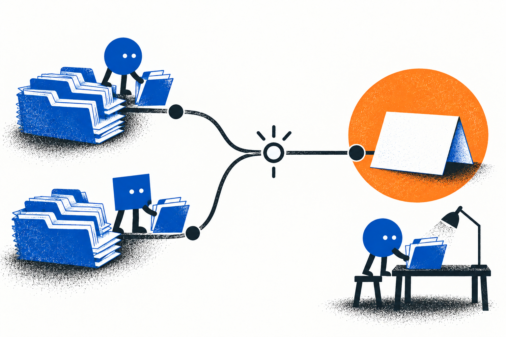
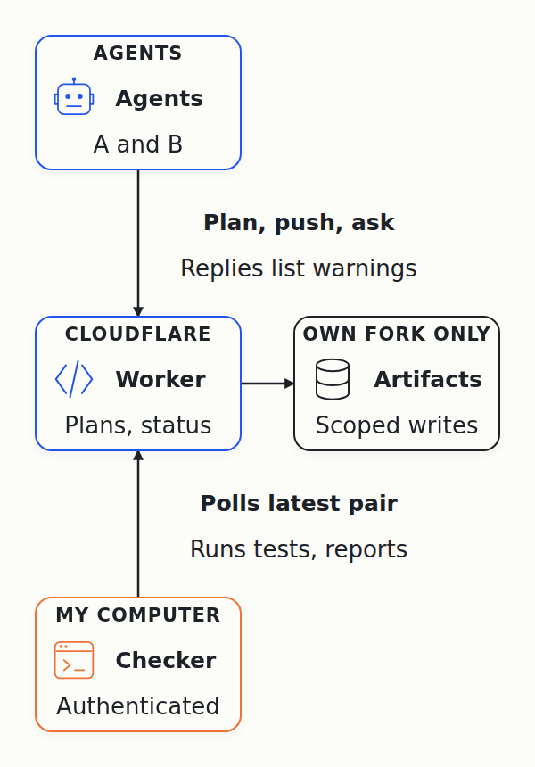

# Day 13: I Recorded the Demo and Submitted the Entry

I recorded the demo for Cloudflare's [competition to build the next Git platform](https://blog.cloudflare.com/next-git-platform-on-cloudflare/) and submitted my entry, Agent Branches. You can watch [the video I submitted](https://www.loom.com/share/f8b67486801b4cee8d8970fa3d405553).

Since early October, a team of AI coding agents has been researching which Git-like tools coding agents need, and building the entry. It started with my own problem: when several agents change one project at the same time, their changes clash.

## Plain Git can already do that

In the first demo, Agent A and Agent B pushed changes, and then the demo merged them and ran the tests. My objection was that plain Git can already do that. Worktrees give each agent its own folder and branch, and Git finds merge conflicts on its own.

So I changed the pitch: I'm not building a better Git, I'm building a coordination layer on top of it. Git stores and merges changes. The layer tracks who's changing what, and whether the latest changes from different agents have been checked together.

When two agents are about to edit the same file, I want them to find out before they spend an hour on it. Finding out at merge time is too late. With an early warning, there's still time to agree who owns the file, split the task or rebase and check again.

## Making the demo tell that story

For the new pitch, I needed a demo I could narrate. I asked the agents to cut it to one example. In it, commands play Agent A and Agent B, so no AI model runs during the demo.

First the scripted agents change different files, push, and the status comes back clean. Then both change the same file, shared.txt, and the status shows a conflict warning naming both of them. The main branch stays untouched.

Each step has a short title and waits for me to press Space before it runs, then waits again so I can explain the output. I also asked the agents to replace the raw API calls with our own command-line tool. Registering a task and reading the status are now short commands.

## After the recording

The demo finds the clash only after both agents push, which is later than I want. So after recording, I asked the agents to work through the rest of my feedback. They built everything below after the video, so the video doesn't show it.

They added two pieces that work at different moments:

- Planned files, before anyone edits: when an agent registers a task, it can list the files it plans to change. If another agent already listed the same file, the second agent sees the overlap right away, and the first sees it the next time it checks the status. It only covers files an agent lists, and an overlap isn't proof of a future conflict.
- A watcher, after each push: a checker that runs on my computer, separate from the agents. It keeps asking the coordination service for each agent's latest pushed commit. When one changes, it tests the newest pair together and sends the service the result: clean, failing tests or a conflict.

I host the Git repositories and the coordination service on Cloudflare, and the service never runs agent code. The checks run on my own computer, and agents see the warnings and results when they ask the service for the status.

A separate agent reviewed the work and sent it back first. One problem it found: a check could count as passed when its output only printed a passing number. Now a check counts only if real tests ran and passed. After the fixes, the reviewer [accepted the changes](https://github.com/alexeygrigorev/cloudflare-agent-git/issues/114#issuecomment-6181165157).

So far the watcher has passed one reviewed test with scripted agents, and this version isn't on Cloudflare yet. I still don't know whether it helps real agents more than plain worktrees. That's the next test: two real AI agents on a small real task, once with the watcher and once with plain worktrees.
